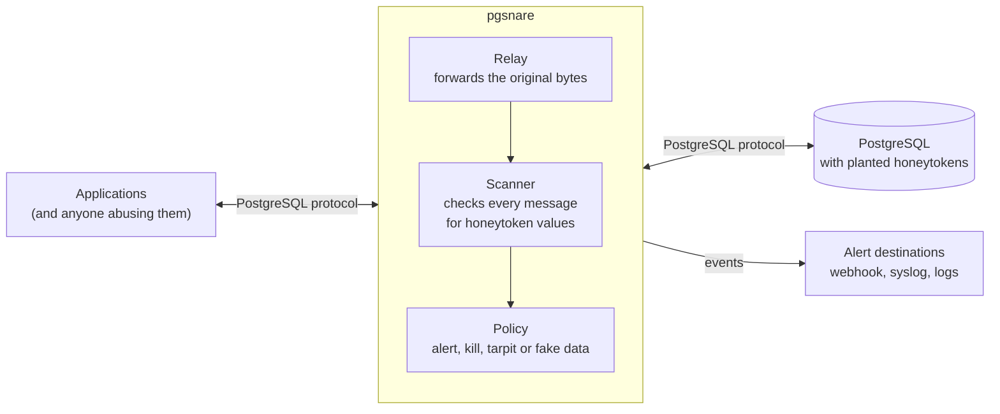

# pgsnare

A PostgreSQL proxy that catches data theft with honeytokens.

> [!IMPORTANT]
> pgsnare is under construction. It finds honeytokens and answers them, and the repository holds a container image definition, a Helm chart, a Compose example and the release procedure, but **no version has been released**: there is no published image, chart or binary yet, and the release procedure has never run for real. The integration tests have so far run only `alert` and `kill` against PostgreSQL. Do not rely on pgsnare to protect production data yet.
> [Status and roadmap](#status-and-roadmap) shows what exists today. The design is described in [docs/high-level-design.md](docs/high-level-design.md). To try it, follow the [quickstart](docs/quickstart.md).

## What it is

pgsnare sits between your applications and a real PostgreSQL server and relays their traffic byte for byte.

You plant **honeytokens** in the database: fake rows or values, such as a made-up administrator account, that no legitimate code ever reads. pgsnare scans every message that passes through it. When a honeytoken value appears, someone is reading data they should not, and pgsnare responds the way you configured for that token: raise an alert, kill the session, slow it down, or pollute what it receives with fake data.

## Why

- Database breaches are often discovered late, and usually by someone outside the organisation.
- Rules that inspect query text are noisy and easy to evade with aliases, views, encodings or an ORM.
- A honeytoken has almost no false positives, because legitimate code never touches it. What matters is that the value left the database, not how the query was written.

## How it works



1. Applications connect to pgsnare instead of the database. Only the host and port change.
2. pgsnare relays the login to the database untouched. It never learns a password and holds no database credentials.
3. Every message, in both directions, is scanned for honeytoken values before it is forwarded.
4. On a hit, pgsnare emits an event and applies the response configured for that token.

## Responses

| Response | What happens |
|---|---|
| `alert` | An event goes to your alert destinations. The session continues. |
| `kill` | The row holding the token is withheld, the client receives an ordinary-looking fatal error, and the database session is cancelled and closed. |
| `tarpit` | Everything sent to the client from then on is delayed, within limits that protect the database. |
| `fake_data` | The result is padded with generated rows, so the stolen data is polluted. |

Responses are set per token. They can be combined, and escalated after repeated hits.

### Configuring responses

```yaml
tokens:
  - id: users-admin-backup
    values: ["svc.backup.8f3k2q@mail.example"]
    actions: [alert, kill]                  # default [alert]
    escalate: { after_hits: 3, to: [kill] }

exemptions:
  - { db_user: backup, client_cidr: 192.0.2.5/32 }

actions:
  kill:    { sqlstate: "57P01", message: terminating connection due to administrator command }
  tarpit:  { delay: 2s-30s, max_duration: 10m, max_sessions: 50, max_bytes_per_second: 1KiB }
  fake_data: { rows: 500 }
```

[The example configuration](examples/config/pgsnare.yaml) lists every setting with its default.

- **Exemptions.** A hit in a session covered by an exemption is counted (`pgsnare_hits_total{kind="token_exempt"}`) and triggers nothing: no event, no response. An entry with a user and an address range covers a session only when both match. A user name counts only after the database has accepted the login; before that only an address range can exempt. `application_name` and other client fields never exempt. `SET ROLE` does not change an exemption, which follows the login user.
- **Escalation.** Hits are counted for each token in each session. From the `after_hits`-th hit on, the responses of `to` are carried out instead of `actions`. A session that hits more than 1,024 different tokens gets the escalated response for every further token.
- **Flagged sessions.** After its first hit, a session reports each later statement with a `session_activity` event.
- **Combining.** `kill` overrides `tarpit` and `fake_data` when they are in the same set. A response that cannot be carried out falls back to `alert`.

What each response does, and where it stops:

- **`alert`** emits a `token_hit` event through the dispatcher, which never makes the session wait. A full queue loses the event and counts it. Each sink keeps a quarter of its queue for hits, so a flood of other events does not push a hit out; a queue of fewer than four places keeps none.
- **`kill`** withholds the message, sends the client a `FATAL` error with the configured SQLSTATE and message, sends a cancel request with the key the database gave the session, and closes both connections. It needs no database credentials. If the client has already received part of the message, both connections are closed without an error. A hit in a login message is answered before the database is reached.
- **`tarpit`** delays what is sent to the client: each read from the database that has bytes for the client waits a random time in the `delay` range, and `max_bytes_per_second` slows it further. Nothing more is read from the database while the session is held. A session is held at most `max_duration`, and at most `max_sessions` sessions are held at once, counted for the whole process; past either limit the session is killed.
- **`fake_data`** adds `rows` made-up rows before the end of a result and raises the row count to match. The rows recombine values sampled from the real rows of that result, with generated bait in credential-like columns. It is done only for a text-format result of one `SELECT`, `TABLE` or `VALUES` statement that the proxy has seen the description of, with at most 256 text columns, and never after a statement with a row limit in the same session. Otherwise the hit is reported as `alert`. At most 8 MiB are added to a result. Rows are added at the end, so an `ORDER BY` other than ascending `id` is broken.

Limits to know about:

- Detection is of the value as it travels. A value that is hashed, cut or re-encoded inside the database does not match, and `kill` withholds the message that holds the token, not the messages before it. A message larger than `max_buffered_frame` is scanned as a stream, and bytes before the token inside it can reach the client.
- Statements are attributed by following the protocol, not by parsing SQL; only the optional [SQL rules](#sql-rules) parse. A statement prepared or deallocated by an SQL command is not followed. When the proxy loses its place, the event says the statement is unknown, and the hit is still raised.
- `query_redaction: full` is a debugging mode. It puts statements into events as they were sent, so **a password written in a statement is shown**, to everyone who can read the events and the log (token values are still removed). `fingerprint`, the default, is the setting to use in production.
- If `fake_data` was decided and rows cannot be added at the end of the result, for example after a cursor `FETCH`, the result goes on unchanged, though the event says `fake_data`.

### Reload

The policy (tokens, exemptions, escalation, response settings, `query_redaction`) is read again on `SIGHUP` and when a file of the configuration, its directory, or the directory of a token-file pattern changes. Changes are looked for each second and acted on once nothing has changed for one more second, which also sees the swap of a mounted volume. The new policy is built in full and swapped in one step. A session sees it at its next message, and a COPY keeps the policy it started with. A policy that does not load is refused: the old one stays, the log names the file and the reason, and `pgsnare_reload_failures_total` counts it. Listeners, TLS, sinks, the admin and metrics listeners and the grace period need a restart, and a reload that changes them says so in the log. A session that is flagged stays flagged after a reload, also if it becomes exempt. The values of tokens that a reload removes are no longer removed from events and logs.

### SQL rules

Rules are optional and are off unless the configuration has a `rules` section. They look at the statement, with the grammar of PostgreSQL 18, before any of it reaches the database. Honeytokens remain the main signal: the rules add checks for the statements an intruder tends to send, and they never decide whether a token is found.

```yaml
rules:
  on_parse_failure: block                   # allow, alert (default) or block
  max_parse_bytes: 64KiB                    # a longer statement is not parsed; at most 1MiB
  catalog_enumeration: { actions: [alert], exclude_users: [migrator] }
  unbounded_read: { tables: [public.users], actions: [alert], listeners: [main] }
  row_threshold: { tables: [public.users], max_rows: 1000, actions: [alert, tarpit], users: [app] }
  functions:
    names: [pg_read_file, pg_read_binary_file, pg_ls_dir, pg_stat_file, lo_import, lo_export,
            pg_sleep, pg_sleep_for, pg_sleep_until, query_to_xml, table_to_xml, cursor_to_xml,
            schema_to_xml, database_to_xml, dblink, dblink_exec]
    actions: [alert, kill]
```

`kill` and `tarpit` on a rule that judges a statement (`catalog_enumeration`, `unbounded_read`, `functions`) are only certain with `on_parse_failure: block`. Under `allow` and `alert`, a statement that cannot be analysed is passed on without being judged, and the list of such statements below is long. `pgsnare config check` warns about a configuration that pairs them.

| Rule | Fires when |
|---|---|
| `catalog_enumeration` | A statement names a relation of `pg_catalog` or `information_schema`, or an unqualified relation whose name starts with `pg_` |
| `unbounded_read` | A listed table is read with no `WHERE` and no `LIMIT` or `FETCH`: also through `TABLE t`, `COPY t TO`, sub-selects, CTEs and `RETURNING`. `LIMIT ALL`, `LIMIT NULL` and a `WHERE` that is one bare constant, also when the constant is cast (`true::bool`, `NULL::bigint`), are no bound |
| `row_threshold` | A result has more than `max_rows` rows. It fires once for that result |
| `functions` | A listed function is named, with or without `pg_catalog.`, however the name is written: case, quotes, comments and Unicode escapes do not hide it. That includes a statement that builds something on the function: an operator, an aggregate, a type, a cast, a trigger, a language, a foreign-data wrapper or an access method |

- **Scope.** Each rule takes optional `listeners` and `users` lists, where it is on, and `exclude_users`, for whom it is off. A list that is left out means all; an excluded user wins. A rule set that does not apply to a session costs that session nothing.
- **Responses.** A hit takes the path of a token hit: an exempt session is counted and nothing else, the session is flagged, and `alert`, `kill` and `tarpit` are carried out by the same code. The event is `rule_hit` and names the rule. `fake_data` has no result to add rows to before a statement runs, so on the three rules that fire before a result it is carried out and reported as `alert`; on `row_threshold` it follows the conditions it has for a token. Rules have no escalation.
- **The statement is held.** In a session a rule applies to, a `Query` or `Parse` is searched for honeytokens as always and then held, together with what the client sends behind it, until the parser has answered. The database sees nothing of it before that. The client is not read meanwhile, and the server's traffic goes on. The wait is part of `pgsnare_added_latency_seconds`.
- **The parser is isolated.** It is C code that reads attacker-controlled text. It runs only on its own threads (two, with 16 MiB of stack each), behind a queue of 256 jobs that answers "busy" instead of waiting, with each job guarded against a panic. The text is checked first for its size, valid UTF-8, an embedded NUL byte and nesting. Parsing can take up to about 1,500 times the size of a statement in memory, on both threads at once, so the default `max_parse_bytes` is 64 KiB: about 188 MiB at the worst. **A proxy with rules needs that memory on top of the rest**: give its container 256 MiB plus 3,000 times `max_parse_bytes`, which is 512 MiB with the default, or a client that is logged in can have the process ended for lack of memory. `pgsnare config check` warns when the worst case is above 256 MiB (a `max_parse_bytes` over about 87 KiB). Analyses are cached by the SHA-256 of the text, up to 4,096 entries and 8 MiB. A statement is parsed once, however many times a prepared statement runs.
- **Parse failures.** A statement without an analysis follows `on_parse_failure`: `allow` passes it on and counts it, `alert` also raises a `parse_failure` event, and `block` raises the event and ends the session with the error of `kill` before any byte of the statement is passed on. Counted in `pgsnare_parse_failures_total` whatever the setting, by reason (`busy`, `timed_out`, `too_deep`, `opaque_body` and so on: a fixed list of names), so that busy parser threads can be told from statements nobody could read; the event does not say the reason. The parser threads show their own counters too: `pgsnare_parser_statements_total` (parsed, or answered from the cache), `pgsnare_parser_busy_total`, `pgsnare_parser_panics_total`, and the entries and bytes of the cache. The cases are: a statement the parser refuses or that nests too deep, one over `max_parse_bytes`, a malformed message, a message sent in parts, busy parser threads, no answer within five seconds, a panic, a session whose `client_encoding` is not `UTF8` or whose `standard_conforming_strings` is not `on` (or either not yet reported), a statement sent before the database has answered one that may change either setting, and a statement that carries code as a string (`DO`, `CREATE FUNCTION`, `CREATE PROCEDURE`). A `FunctionCall` message names its function by number, so it is a parse failure where the `functions` rule applies. A migration tool that sends large statements or function bodies will raise `parse_failure` events: exclude its user from the rules.
- **The row threshold** counts the `DataRow`s of a result, and each `CopyData` of a `COPY ... TO STDOUT`, through the statement tracker. A result is everything one `Query` returns, or everything one portal returns over all its `Execute`s. A statement arms the threshold when it names a listed table, whatever it does with it: an `INSERT ... RETURNING` returns rows too. Cautiously, a statement that runs a stored one (`EXECUTE`, `FETCH`), a statement without an analysis and a result the tracker cannot place are held to the threshold whatever table they read. Once a session has passed on a statement that stores a query over a listed table under another name (`CREATE VIEW`, `CREATE TABLE ... AS`, `SELECT ... INTO`, `CREATE RULE`), a statement that carries code, or any statement without an analysis, every later result of that session is held to the threshold. A view over a listed table that exists already, or is made by another session, is not known to pgsnare: list it with the table.
- **Redaction.** With `query_redaction: fingerprint` (the default, and the setting recommended for production), an event about an analysed statement shows the parser's normalised statement, with its constants left out, and the parser's fingerprint (16 hexadecimal digits). The SHA-256 form (64 digits) is shown instead when the statement has no analysis, when its kind is not one whose constants the parser replaces everywhere (`SELECT`, `INSERT`, `UPDATE`, `DELETE`, `MERGE`, `SET`, transaction statements, `CALL`, `DECLARE`), when the form still holds a comment or a string, and when it holds a honeytoken of the policy in force. `full` is a mode for debugging: it can show a statement as it was sent, passwords included.
- **A reload** replaces the rules with the rest of the policy. A held statement is judged by the rules it was held under, and the cache holds analyses, not verdicts.

What the rules cannot see:

- Code in a string: the body of a `DO` block or of a function, dynamic SQL (`EXECUTE format(...)`), `dblink`, `query_to_xml`. Such a statement is a parse failure, and what the code does is not judged.
- An operator, aggregate, type or cast over a listed function that exists in the database already, or was defined by a connection that does not pass through pgsnare. Defining one through pgsnare names the function, and sets off the rule.
- A function or procedure of the database that reads a listed table, or that changes `client_encoding` or `standard_conforming_strings` when it is called: its code is not in the statement that calls it.
- Functions that look up or list objects without naming a catalogue relation: `to_regclass`, a cast to `regclass`, `has_table_privilege` and its relatives, `schema_to_xmlschema`. `catalog_enumeration` looks at relations only. Put such functions under `functions` where they matter.
- A statement run by name. `PREPARE x AS ...` is judged when it arrives; `EXECUTE x` and a `FETCH` from a cursor are not tied back to it. A statement prepared before a reload is not judged by the rules loaded since, and an `Execute` of a prepared statement raises nothing again.
- The settings that decide how the database reads a statement are followed through what the server reports. A statement sent before the server has answered one that may change `client_encoding` or `standard_conforming_strings` (a `SET` or `RESET` of either, `RESET ALL`, `DISCARD`, a call of `set_config`, `EXECUTE`, code in a string, a `FunctionCall`, any statement without an analysis) is a parse failure. After such a change inside a transaction, and until the transaction has ended, the same holds for every statement sent before the server has answered the one before it. Clients that send statements ahead in these situations will see parse failures.
- The parser threads, their queue and the five-second wait are shared by all sessions and have fixed sizes. Sessions that send many large, new statements delay the analyses of the others, whose statements then become parse failures (`busy`, or no answer in time).
- With `query_redaction: fingerprint` the parser reads each new statement up to three times (analysis, normalised form, fingerprint), once per text.
- The rules are heuristics: `WHERE 1=1` and `LIMIT 1000000000` count as bounds. The row threshold is the real bound.
- A rule needs the build feature `rules` (see [Building and testing](#building-and-testing)). A build without it refuses a configuration that has a `rules` section.

## Design goals

- **Invisible to clients.** Logins, TLS, prepared statements, COPY, notifications and cancellation work as they do against the database directly.
- **Detection on data, not on query text.** A honeytoken is found in result rows, COPY output, error messages and notifications, and in what clients send.
- **Secure by default.** No database credentials, fail-closed inspection, strict limits on everything read from the network, and no `unsafe` code in pgsnare's own crates.
- **PostgreSQL 15 to 18.** The versions supported upstream, including the newer wire protocol 3.2 and direct TLS.
- **Runs where containers run.** A standalone container, or Kubernetes as a central proxy or a sidecar, without needing exceptions from a locked-down platform.

## What it will not catch

A security tool should be clear about its limits.

- **Transformed values.** A value that is hashed, cut, re-encoded or encrypted inside the database before it leaves does not match.
- **Blind extraction.** Boolean or time-based SQL injection infers data without ever returning it.
- **Rows already sent.** `kill` withholds the row that contains the token, not the rows that came before it in the same result.
- **Traffic that bypasses it.** The network must force database connections through pgsnare.
- **A honeytoken used as a password.** Login messages are not scanned, so a honeytoken that an intruder sends as a password is not detected. A honeytoken used as a user name, or in a query, is. This is a known limit; alternatives are on the [future work](#future-work) list.

The design document explains each of these and what reduces the exposure.

## Deployment options

| Option | Shape | Start here |
|---|---|---|
| Try it | PostgreSQL 18, pgsnare with seeded tokens and a demo webhook receiver, in Compose | [Quickstart](docs/quickstart.md), [`examples/compose`](examples/compose/README.md) |
| Standalone container | Docker or Podman, including Compose | [Deploying pgsnare](docs/deployment.md) |
| Kubernetes, central proxy | A Deployment and Service in front of the database, installed with a Helm chart | [Chart README](deploy/chart/pgsnare/README.md) |
| Kubernetes, sidecar | A pgsnare container inside each application pod, as a native sidecar where the cluster supports it | [`deploy/sidecar`](deploy/sidecar/README.md) |

Because pgsnare relays logins instead of terminating them, the TLS setup has to follow a few rules; see [Authentication and TLS](docs/high-level-design.md#7-authentication-and-tls) and [Deploying pgsnare](docs/deployment.md#tls-which-setup-to-choose).

**The image.** One static binary on an Alpine base pinned by digest, run by user `65532`, with a health check that calls `pgsnare healthcheck`. It is built for x86_64 and aarch64, with the default features, so it holds the [SQL rules](#sql-rules). **The base has a shell and a package manager**: that is the owner's choice of base. What confines the process is that it is not root, holds no capability and has a read-only root filesystem when started as the chart and the examples start it.

**Releases.** None exists yet. A release will be built only by CI, from a version tag that equals the version in `Cargo.toml` and points at a commit on `main`: the binaries and the image for both architectures, and the chart as an OCI artefact in the GitHub Container Registry (`ghcr.io/guidorugo`), with plain manifests rendered from the chart, checksums, SBOMs, signatures and build provenance. The release procedure is rehearsed on every change against a registry inside the CI runner, with a signing key made for the run; keyless signing, provenance and the real registry have not run. See [Verifying a release](docs/verifying-a-release.md) for how a release will be checked, and [Releasing](docs/releasing.md) for the owner's procedure. The first version is 0.0.1.

**Guides.**

- [Quickstart](docs/quickstart.md): the Compose example, from `up` to a first alert.
- [Deploying pgsnare](docs/deployment.md): standalone and Kubernetes, and the TLS setups.
- [Hardening guide](docs/hardening.md).
- [Honeytoken placement](docs/honeytoken-placement.md).
- [Threat model and known gaps](docs/threat-model.md).

## Future work

- **Look for alternatives to detect a honeytoken used as a password.** Login messages are not scanned today (see [What it will not catch](#what-it-will-not-catch)).
- SQL rules in the Helm chart, which cannot set them yet.
- The first release, and with it the checks that cannot run before: keyless signing, provenance and publishing to the registry.
- TLS on both legs in the cluster tests, other Kubernetes versions and other network plugins.

## Security

- To report a vulnerability, use [GitHub's private vulnerability reporting](https://github.com/guidorugo/pgsnare/security/advisories/new). Please do not open a public issue for a security problem. [SECURITY.md](SECURITY.md) has the details.
- The threat model and the security requirements every part of pgsnare must meet are in [Security design](docs/high-level-design.md#15-security-design).

## Status and roadmap

pgsnare cannot be relied on yet: it detects and responds, but no version has been released, and the integration tests have so far run only `alert` and `kill` against PostgreSQL. What exists today:

- **Relay.** `pgsnare run` puts a proxy between clients and a database: TLS on both legs, logins, simple and extended queries, COPY, replication, notifications, function calls and cancellation, for protocol 3.0 and 3.2. Tests compare what a client sees from PostgreSQL 15 to 18 directly and through pgsnare, in every supported TLS setup.
- **Detection.** Every message, in both directions, is scanned for honeytoken values before it is forwarded, and so are the startup parameters and the user name at login. A value split across reads, across the chunks of a large message or across `CopyData` messages is found. A hit becomes a `token_hit` event that names the token, the session and the statement.
- **Policy and responses.** Per token: `alert`, `kill`, `tarpit` and `fake_data`, combinations, escalation after repeated hits, exemptions by user and address range, and a `session_activity` event for each statement of a flagged session. Counted in `pgsnare_queries_total`, `pgsnare_hits_total` and `pgsnare_actions_total`. See [Configuring responses](#configuring-responses). The responses are tested with the proxy running in test programs, with a real client socket and a database made for the test. The integration tests also read a honeytoken through the proxy from PostgreSQL, once with `alert` and once with `kill`; `tarpit`, `fake_data` and reload are not yet run against PostgreSQL.
- **SQL rules.** Optional rules judge a statement with the grammar of PostgreSQL 18 before it is passed on: catalogue enumeration, unbounded reads of listed tables, functions from a list, and a row threshold counted through the statement tracker. They are configured per rule, listener and user, answer like a token hit, and follow a parse-failure policy (`allow`, `alert`, `block`). See [SQL rules](#sql-rules). Tested with the real parser in test programs and fuzzed; the integration tests run one rule (`functions` with `kill`) against PostgreSQL 15 to 18.
- **Reload.** `SIGHUP` or a change to a configuration or token file replaces the policy without dropping a session. See [Reload](#reload).
- **Events and observability.** Events reach four sinks through a dispatcher that never makes database traffic wait: a signed webhook over verified HTTPS, standard output, a file and syslog. `pgsnare run` serves `/healthz` and `/readyz` on an admin listener and Prometheus metrics on a listener of their own, both on loopback by default, and `pgsnare healthcheck` asks the admin listener. The log is JSON, one object for each line, on standard error, written by a thread of its own through a queue, so a log nobody reads costs lines and never makes a session wait. One redaction layer stands before every event, log line and metric label.
- **Wire protocol.** Framing, message views and encoders for protocol 3.0 and 3.2, tested against traffic captured from PostgreSQL 15 to 18.
- **Honeytoken matcher.** It finds token values in a stream of bytes, however the stream is split.
- **Configuration and events.** The configuration format, with a [complete example](examples/config/pgsnare.yaml), and the event format.
- **Honeytoken tools.** `pgsnare token generate` makes new honeytokens: made-up accounts, password hashes in the formats of bcrypt, Argon2id and SCRAM-SHA-256, API keys, card numbers and markers for free text. It prints the SQL statement that plants them and the token file that matches, and connects to nothing. `pgsnare token list` and `pgsnare token test` look into a configuration without ever showing a value. `pgsnare config check` reports every problem of a configuration and warns about settings that give up protection.
- **Image and chart.** [`deploy/Dockerfile`](deploy/Dockerfile) builds a static binary and an image for x86_64 and aarch64. CI tests the image as pulled from a registry: a numeric user, no setuid file, a read-only root filesystem with no capabilities, a login through it, a `token_hit`, a session ended by an SQL rule and its `rule_hit`, a health check that turns `healthy` and a stop with status 0 on `SIGTERM`; and scans it for known vulnerabilities on every build and nightly. The [Helm chart](deploy/chart/pgsnare/README.md) is checked with `helm lint`, rendered against a pinned set of Kubernetes schemas, and installed into a `kind` cluster that enforces the restricted Pod Security Standard and NetworkPolicy. The cluster tests run on Kubernetes 1.37 only: install to first alert for the central proxy and the sidecar, a token added through a changed Secret without a restart, a rolling update that lets a long statement finish, and isolation of pods that are not on the allowed list, inwards and outwards. TLS in the cluster is not run: the TLS mounts are rendered and checked, and the example uses TLS on both legs.
- **Examples and guides.** A [Compose example](examples/compose/README.md) with a smoke test that CI runs on every change, and the guides listed under [Deployment options](#deployment-options).
- **Release procedure.** [`.github/workflows/release.yml`](.github/workflows/release.yml) runs only from a version tag and has never run. The scripts it uses are rehearsed on every change.
- **Toolchain.** Builds run in containers with pinned versions. Every change is checked for formatting and lints, tests, fuzz targets, dependency advisories and licences, secrets, and private network addresses.

The steps to the first release:

| Step | What it delivers | State |
|---|---|---|
| 1. Relay | A proxy that real clients cannot tell from the database | Done |
| 2. Detect and alert | Honeytokens, events and sinks. The first usable version | Built: detection, events, sinks, health and metrics. `tarpit`, `fake_data` and reload not yet run against PostgreSQL |
| 3. Respond | Kill, tarpit, fake data and exemptions | Built, with the same limit |
| 4. SQL rules | Optional checks on the statements themselves | Built, behind the `rules` build feature. Only the `functions` rule with `kill` has run against PostgreSQL |
| 5. Prove and ship | Detection corpus, fuzzing, benchmarks, container image, Helm chart and documentation | Image, chart, examples, release procedure and guides built; the first release (0.0.1) is not made. Detection corpus and benchmarks: not run |

Progress is tracked in [the pgsnare epic](https://github.com/guidorugo/pgsnare/issues/2).

## Building and testing

You need Docker with the Compose plugin, and `make`. Every build and test runs in containers with a pinned toolchain, so nothing else has to be installed.

| Command | What it does |
|---|---|
| `make build` | Builds the workspace |
| `make test` | Runs the tests of every crate, with and without the optional SQL rules. They include the sinks against receivers made for the test, and the leak test |
| `make lint` | Checks formatting, runs Clippy with warnings denied, and builds the API documentation |
| `make itest` | Builds pgsnare and runs it in front of PostgreSQL 15 to 18: the differential scenarios, the login table, the container checks, and what the commands print |
| `make fuzz` | Runs every fuzz target for a short time |
| `make deny` | Checks the advisories, licences and sources of every dependency |
| `make scan` | Scans for secrets and private network addresses |

The SQL rules are a build feature, `rules`, on by default. It brings in PostgreSQL's own parser, which is C code, so the build needs a C compiler (the development image has one); it does not need libclang. The build environment must not have `protoc` on its `PATH`: the parser's build script would then generate its Rust types again and overwrite the ones that came with the crate, which the rules were written and tested against. `make lint` fails when the development image has it. `make test` and `make lint` run a second time with `--no-default-features`, a build without the parser, which must pass every test except the rule tests.

CI runs the last six on every pull request, and all of them must pass before it can be merged.

The image, the chart, the cluster tests, the Compose example and the release rehearsal are not `make` targets: they run in CI only, in the workflow [`deploy.yml`](.github/workflows/deploy.yml), on every pull request, every push and nightly. They build and scan the image, check the chart, start a `kind` cluster and a Compose project, and rehearse a release against a registry inside the runner. Nothing of them publishes anything. The scripts are under `deploy/tests/`, and each can be read as the documented procedure.

`tests/bench.sh` runs a small benchmark, against PostgreSQL directly and through pgsnare. It gives a baseline for one machine and is not part of CI.

## Repository layout

| Path | Contents |
|---|---|
| `crates/pgsnare-proto` | The PostgreSQL wire format: framing, message views and encoders. No I/O. |
| `crates/pgsnare-core` | Session logic (scanning, statement tracking, responses), detection, policy, actions (`kill`, `tarpit`, `fake_data`), the SQL rules (with the `rules` feature: analysis of a statement and the rule set), bait generators and the event format. No I/O. |
| `crates/pgsnare` | The runtime and the `pgsnare` command: listeners, TLS, configuration, the policy reload, the event dispatcher and its sinks, the health and metrics listeners, the log and the redaction layer, and the parser threads of the SQL rules. |
| `crates/bindgen-prebuilt` | A stand-in for the `bindgen` crate, put in its place by `[patch.crates-io]`. The parser's build script asks for `bindgen`, which needs libclang and `libloading`; this crate hands out the declarations of the parser's C interface that were made ahead of time, and refuses to build if the parser's headers or the target differ. |
| `examples/config` | A complete configuration file, with every setting explained. |
| `examples/compose` | The Compose example: PostgreSQL 18, pgsnare with seeded tokens, a demo webhook receiver, and a smoke test. |
| `deploy/Dockerfile` | The image, and the stage that exports the binary. |
| `deploy/chart/pgsnare` | The Helm chart for the central proxy. |
| `deploy/sidecar` | The sidecar definitions, native and classic. |
| `deploy/release` | The scripts that publish, sign and verify a release. |
| `deploy/tools` | The list of every downloaded tool, with its version and checksums, and the installer. |
| `deploy/tests` | The tests of the image, the scan, the chart, the cluster, the release and the repository rules. They run in CI. |
| `tests` | Integration tests. They compare what a client sees from PostgreSQL directly and through pgsnare, try every row of the login table, check pgsnare as a container, and give PostgreSQL what `pgsnare token generate` prints. |
| `docs` | The design, the quickstart, the guides (deployment, hardening, honeytoken placement, threat model), and how to verify and make a release. |
| `.github/workflows` | The checks (`lint`, `test`, `deny`, `scan`, `itest`, `fuzz`), the image and cluster checks (`deploy`) and the release workflow (`release`). |

## License

Apache License 2.0. See [LICENSE](LICENSE).

The binary also holds the code of the packages it depends on, among them the C code of libpg_query and of PostgreSQL that the SQL rules bring in, and their licences require the copyright notice and the licence text to go with every copy. `scripts/notices.sh` collects those notices into `THIRD-PARTY-NOTICES` without writing a licence from memory: it copies only the files the packages carry. `make notices` writes it to `target/THIRD-PARTY-NOTICES`; the image holds it at `/usr/share/doc/pgsnare/THIRD-PARTY-NOTICES`, and every release attaches it.
