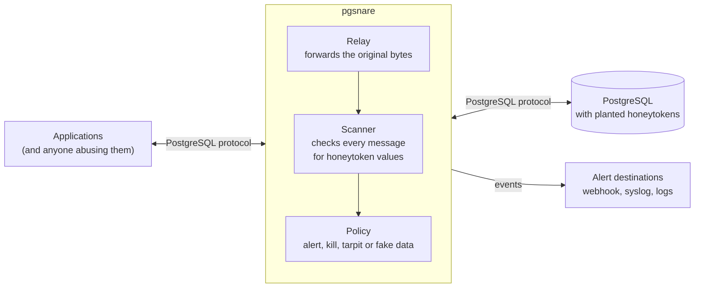

# pgsnare

A PostgreSQL proxy that catches data theft with honeytokens.

> [!IMPORTANT]
> pgsnare is under construction. It relays traffic and detects nothing yet, no version has been released, and nothing here is ready for use.
> [Status and roadmap](#status-and-roadmap) shows what exists today. The design is described in [docs/high-level-design.md](docs/high-level-design.md).

## What it is

pgsnare sits between your applications and a real PostgreSQL server and relays their traffic byte for byte.

You plant **honeytokens** in the database: fake rows or values, such as a made-up administrator account, that no legitimate code ever reads. pgsnare scans every message that passes through it. When a honeytoken value appears, someone is reading data they should not, and pgsnare responds the way you configured for that token: raise an alert, kill the session, slow it down, or pollute what it receives with fake data.

## Why

- Database breaches are often discovered late, and usually by someone outside the organisation.
- Rules that inspect query text are noisy and easy to evade with aliases, views, encodings or an ORM.
- A honeytoken has almost no false positives, because legitimate code never touches it. What matters is that the value left the database, not how the query was written.

## How it works

1. Applications connect to pgsnare instead of the database. Only the host and port change.
2. pgsnare relays the login to the database untouched. It never learns a password and holds no database credentials.
3. Every message, in both directions, is scanned for honeytoken values before it is forwarded.
4. On a hit, pgsnare emits an event and applies the response configured for that token.

## Responses

| Response | What happens |
|---|---|
| `alert` | An event goes to your alert destinations. The session continues. |
| `kill` | The row holding the token is withheld, the client receives an ordinary-looking fatal error, and the database session is cancelled and closed. |
| `tarpit` | Everything sent to the client from then on is delayed, within limits that protect the database. |
| `fake_data` | The result is padded with generated rows, so the stolen data is polluted. |

Responses are set per token. They can be combined, and escalated after repeated hits.

## Design goals

- **Invisible to clients.** Logins, TLS, prepared statements, COPY, notifications and cancellation work as they do against the database directly.
- **Detection on data, not on query text.** A honeytoken is found in result rows, COPY output, error messages and notifications, and in what clients send.
- **Secure by default.** No database credentials, fail-closed inspection, strict limits on everything read from the network, and no `unsafe` code in pgsnare's own crates.
- **PostgreSQL 15 to 18.** The versions supported upstream, including the newer wire protocol 3.2 and direct TLS.
- **Runs where containers run.** A standalone container, or Kubernetes as a central proxy or a sidecar, without needing exceptions from a locked-down platform.

## What it will not catch

A security tool should be clear about its limits.

- **Transformed values.** A value that is hashed, cut, re-encoded or encrypted inside the database before it leaves does not match.
- **Blind extraction.** Boolean or time-based SQL injection infers data without ever returning it.
- **Rows already sent.** `kill` withholds the row that contains the token, not the rows that came before it in the same result.
- **Traffic that bypasses it.** The network must force database connections through pgsnare.

The design document explains each of these and what reduces the exposure.

## Deployment options

| Option | Shape |
|---|---|
| Standalone container | Docker or Podman, including Compose |
| Kubernetes, central proxy | A Deployment and Service in front of the database, installed with a Helm chart |
| Kubernetes, sidecar | A pgsnare container inside each application pod |

Container images and the Helm chart will be published to the GitHub Container Registry. Because pgsnare relays logins instead of terminating them, the TLS setup has to follow a few rules; see [Authentication and TLS](docs/high-level-design.md#7-authentication-and-tls).

## Security

- To report a vulnerability, use [GitHub's private vulnerability reporting](https://github.com/guidorugo/pgsnare/security/advisories/new). Please do not open a public issue for a security problem. [SECURITY.md](SECURITY.md) has the details.
- The threat model and the security requirements every part of pgsnare must meet are in [Security design](docs/high-level-design.md#15-security-design).

## Status and roadmap

pgsnare cannot be used yet: it relays traffic and does not look at it. What exists today:

- **Relay.** `pgsnare run` puts a proxy between clients and a database: TLS on both legs, logins, simple and extended queries, COPY, replication, notifications, function calls and cancellation, for protocol 3.0 and 3.2. Tests compare what a client sees from PostgreSQL 15 to 18 directly and through pgsnare, in every supported TLS setup. It reads the honeytokens of a configuration and does nothing with them yet, and it has no event sinks, no health endpoint and no metrics.
- **Wire protocol.** Framing, message views and encoders for protocol 3.0 and 3.2, tested against traffic captured from PostgreSQL 15 to 18.
- **Honeytoken matcher.** It finds token values in a stream of bytes, however the stream is split.
- **Configuration and events.** The configuration format, with a [complete example](examples/config/pgsnare.yaml), and the event format.
- **Honeytoken tools.** `pgsnare token generate` makes new honeytokens: made-up accounts, password hashes in the formats of bcrypt, Argon2id and SCRAM-SHA-256, API keys, card numbers and markers for free text. It prints the SQL statement that plants them and the token file that matches, and connects to nothing. `pgsnare token list` and `pgsnare token test` look into a configuration without ever showing a value. `pgsnare config check` reports every problem of a configuration and warns about settings that give up protection.
- **Toolchain.** Builds run in containers with pinned versions. Every change is checked for formatting and lints, tests, fuzz targets, dependency advisories and licences, secrets, and private network addresses.

The steps to the first release:

| Step | What it delivers | State |
|---|---|---|
| 1. Relay | A proxy that real clients cannot tell from the database | Done |
| 2. Detect and alert | Honeytokens, events and sinks. The first usable version | Not started |
| 3. Respond | Kill, tarpit, fake data and exemptions | Not started |
| 4. SQL rules | Optional checks on the statements themselves | Not started |
| 5. Prove and ship | Detection corpus, fuzzing, benchmarks, container image, Helm chart and documentation | Not started |

Progress is tracked in [the pgsnare epic](https://github.com/guidorugo/pgsnare/issues/2).

## Building and testing

You need Docker with the Compose plugin, and `make`. Every build and test runs in containers with a pinned toolchain, so nothing else has to be installed.

| Command | What it does |
|---|---|
| `make build` | Builds the workspace |
| `make test` | Runs the tests of every crate, with and without the optional SQL rules |
| `make lint` | Checks formatting, runs Clippy with warnings denied, and builds the API documentation |
| `make itest` | Builds pgsnare and runs it in front of PostgreSQL 15 to 18: the differential scenarios, the login table, the container checks, and what the commands print |
| `make fuzz` | Runs every fuzz target for a short time |
| `make deny` | Checks the advisories, licences and sources of every dependency |
| `make scan` | Scans for secrets and private network addresses |

CI runs the last six on every pull request, and all of them must pass before it can be merged.

`tests/bench.sh` runs a small benchmark, against PostgreSQL directly and through pgsnare. It gives a baseline for one machine and is not part of CI.

## Repository layout

| Path | Contents |
|---|---|
| `crates/pgsnare-proto` | The PostgreSQL wire format: framing, message views and encoders. No I/O. |
| `crates/pgsnare-core` | Session logic, detection, policy, actions, bait generators and the event format. No I/O. |
| `crates/pgsnare` | The runtime and the `pgsnare` command: listeners, TLS, configuration and sinks. |
| `examples/config` | A complete configuration file, with every setting explained. |
| `tests` | Integration tests. They compare what a client sees from PostgreSQL directly and through pgsnare, try every row of the login table, check pgsnare as a container, and give PostgreSQL what `pgsnare token generate` prints. |
| `docs` | The design. |

## License

Apache License 2.0. See [LICENSE](LICENSE).
