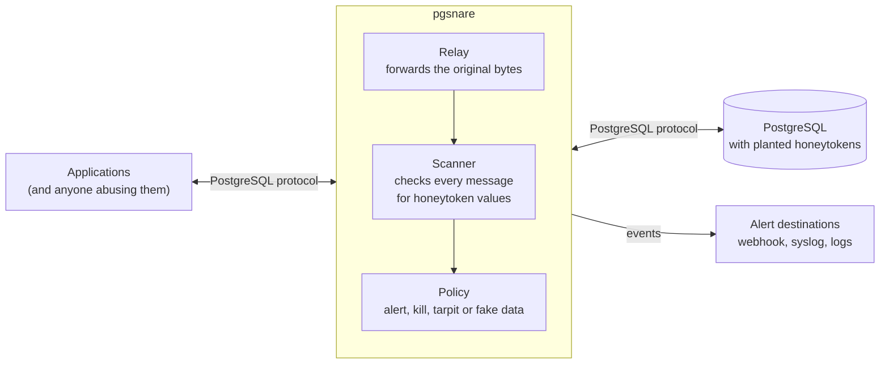

# pgsnare

A PostgreSQL proxy that catches data theft with honeytokens.

> [!IMPORTANT]
> pgsnare is under construction. It finds honeytokens and answers them, but no version has been released, the integration tests have not yet run the responses against PostgreSQL, and nothing here is ready for use.
> [Status and roadmap](#status-and-roadmap) shows what exists today. The design is described in [docs/high-level-design.md](docs/high-level-design.md).

## What it is

pgsnare sits between your applications and a real PostgreSQL server and relays their traffic byte for byte.

You plant **honeytokens** in the database: fake rows or values, such as a made-up administrator account, that no legitimate code ever reads. pgsnare scans every message that passes through it. When a honeytoken value appears, someone is reading data they should not, and pgsnare responds the way you configured for that token: raise an alert, kill the session, slow it down, or pollute what it receives with fake data.

## Why

- Database breaches are often discovered late, and usually by someone outside the organisation.
- Rules that inspect query text are noisy and easy to evade with aliases, views, encodings or an ORM.
- A honeytoken has almost no false positives, because legitimate code never touches it. What matters is that the value left the database, not how the query was written.

## How it works



1. Applications connect to pgsnare instead of the database. Only the host and port change.
2. pgsnare relays the login to the database untouched. It never learns a password and holds no database credentials.
3. Every message, in both directions, is scanned for honeytoken values before it is forwarded.
4. On a hit, pgsnare emits an event and applies the response configured for that token.

## Responses

| Response | What happens |
|---|---|
| `alert` | An event goes to your alert destinations. The session continues. |
| `kill` | The row holding the token is withheld, the client receives an ordinary-looking fatal error, and the database session is cancelled and closed. |
| `tarpit` | Everything sent to the client from then on is delayed, within limits that protect the database. |
| `fake_data` | The result is padded with generated rows, so the stolen data is polluted. |

Responses are set per token. They can be combined, and escalated after repeated hits.

### Configuring responses

```yaml
tokens:
  - id: users-admin-backup
    values: ["svc.backup.8f3k2q@mail.example"]
    actions: [alert, kill]                  # default [alert]
    escalate: { after_hits: 3, to: [kill] }

exemptions:
  - { db_user: backup, client_cidr: 192.0.2.5/32 }

actions:
  kill:    { sqlstate: "57P01", message: terminating connection due to administrator command }
  tarpit:  { delay: 2s-30s, max_duration: 10m, max_sessions: 50, max_bytes_per_second: 1KiB }
  fake_data: { rows: 500 }
```

[The example configuration](examples/config/pgsnare.yaml) lists every setting with its default.

- **Exemptions.** A hit in a session covered by an exemption is counted (`pgsnare_hits_total{kind="token_exempt"}`) and triggers nothing: no event, no response. An entry with a user and an address range covers a session only when both match. A user name counts only after the database has accepted the login; before that only an address range can exempt. `application_name` and other client fields never exempt. `SET ROLE` does not change an exemption, which follows the login user.
- **Escalation.** Hits are counted for each token in each session. From the `after_hits`-th hit on, the responses of `to` are carried out instead of `actions`. A session that hits more than 1,024 different tokens gets the escalated response for every further token.
- **Flagged sessions.** After its first hit, a session reports each later statement with a `session_activity` event.
- **Combining.** `kill` overrides `tarpit` and `fake_data` when they are in the same set. A response that cannot be carried out falls back to `alert`.

What each response does, and where it stops:

- **`alert`** emits a `token_hit` event through the dispatcher, which never makes the session wait. A full queue loses the event and counts it. Each sink keeps a quarter of its queue for hits, so a flood of other events does not push a hit out; a queue of fewer than four places keeps none.
- **`kill`** withholds the message, sends the client a `FATAL` error with the configured SQLSTATE and message, sends a cancel request with the key the database gave the session, and closes both connections. It needs no database credentials. If the client has already received part of the message, both connections are closed without an error. A hit in a login message is answered before the database is reached.
- **`tarpit`** delays what is sent to the client: each read from the database that has bytes for the client waits a random time in the `delay` range, and `max_bytes_per_second` slows it further. Nothing more is read from the database while the session is held. A session is held at most `max_duration`, and at most `max_sessions` sessions are held at once, counted for the whole process; past either limit the session is killed.
- **`fake_data`** adds `rows` made-up rows before the end of a result and raises the row count to match. The rows recombine values sampled from the real rows of that result, with generated bait in credential-like columns. It is done only for a text-format result of one `SELECT`, `TABLE` or `VALUES` statement that the proxy has seen the description of, with at most 256 text columns, and never after a statement with a row limit in the same session. Otherwise the hit is reported as `alert`. At most 8 MiB are added to a result. Rows are added at the end, so an `ORDER BY` other than ascending `id` is broken.

Limits to know about:

- Detection is of the value as it travels. A value that is hashed, cut or re-encoded inside the database does not match, and `kill` withholds the message that holds the token, not the messages before it. A message larger than `max_buffered_frame` is scanned as a stream, and bytes before the token inside it can reach the client.
- Statements are attributed by following the protocol, not by parsing SQL. A statement prepared or deallocated by an SQL command is not followed. When the proxy loses its place, the event says the statement is unknown, and the hit is still raised.
- `query_redaction: full` puts statements into events as they were sent, so a password written in a statement is shown (token values are still removed). The default is `fingerprint`.
- If `fake_data` was decided and rows cannot be added at the end of the result, for example after a cursor `FETCH`, the result goes on unchanged, though the event says `fake_data`.

### Reload

The policy (tokens, exemptions, escalation, response settings, `query_redaction`) is read again on `SIGHUP` and when a file of the configuration, its directory, or the directory of a token-file pattern changes. Changes are looked for each second and acted on once nothing has changed for one more second, which also sees the swap of a mounted volume. The new policy is built in full and swapped in one step. A session sees it at its next message, and a COPY keeps the policy it started with. A policy that does not load is refused: the old one stays, the log names the file and the reason, and `pgsnare_reload_failures_total` counts it. Listeners, TLS, sinks, the admin and metrics listeners and the grace period need a restart, and a reload that changes them says so in the log. A session that is flagged stays flagged after a reload, also if it becomes exempt. The values of tokens that a reload removes are no longer removed from events and logs.

## Design goals

- **Invisible to clients.** Logins, TLS, prepared statements, COPY, notifications and cancellation work as they do against the database directly.
- **Detection on data, not on query text.** A honeytoken is found in result rows, COPY output, error messages and notifications, and in what clients send.
- **Secure by default.** No database credentials, fail-closed inspection, strict limits on everything read from the network, and no `unsafe` code in pgsnare's own crates.
- **PostgreSQL 15 to 18.** The versions supported upstream, including the newer wire protocol 3.2 and direct TLS.
- **Runs where containers run.** A standalone container, or Kubernetes as a central proxy or a sidecar, without needing exceptions from a locked-down platform.

## What it will not catch

A security tool should be clear about its limits.

- **Transformed values.** A value that is hashed, cut, re-encoded or encrypted inside the database before it leaves does not match.
- **Blind extraction.** Boolean or time-based SQL injection infers data without ever returning it.
- **Rows already sent.** `kill` withholds the row that contains the token, not the rows that came before it in the same result.
- **Traffic that bypasses it.** The network must force database connections through pgsnare.

The design document explains each of these and what reduces the exposure.

## Deployment options

| Option | Shape |
|---|---|
| Standalone container | Docker or Podman, including Compose |
| Kubernetes, central proxy | A Deployment and Service in front of the database, installed with a Helm chart |
| Kubernetes, sidecar | A pgsnare container inside each application pod |

Container images and the Helm chart will be published to the GitHub Container Registry. Because pgsnare relays logins instead of terminating them, the TLS setup has to follow a few rules; see [Authentication and TLS](docs/high-level-design.md#7-authentication-and-tls).

## Security

- To report a vulnerability, use [GitHub's private vulnerability reporting](https://github.com/guidorugo/pgsnare/security/advisories/new). Please do not open a public issue for a security problem. [SECURITY.md](SECURITY.md) has the details.
- The threat model and the security requirements every part of pgsnare must meet are in [Security design](docs/high-level-design.md#15-security-design).

## Status and roadmap

pgsnare cannot be used yet: it detects and responds, but no version has been released, and the integration tests have not yet run the responses against PostgreSQL. What exists today:

- **Relay.** `pgsnare run` puts a proxy between clients and a database: TLS on both legs, logins, simple and extended queries, COPY, replication, notifications, function calls and cancellation, for protocol 3.0 and 3.2. Tests compare what a client sees from PostgreSQL 15 to 18 directly and through pgsnare, in every supported TLS setup.
- **Detection.** Every message, in both directions, is scanned for honeytoken values before it is forwarded, and so are the startup parameters and the user name at login. A value split across reads, across the chunks of a large message or across `CopyData` messages is found. A hit becomes a `token_hit` event that names the token, the session and the statement.
- **Policy and responses.** Per token: `alert`, `kill`, `tarpit` and `fake_data`, combinations, escalation after repeated hits, exemptions by user and address range, and a `session_activity` event for each statement of a flagged session. Counted in `pgsnare_queries_total`, `pgsnare_hits_total` and `pgsnare_actions_total`. See [Configuring responses](#configuring-responses). The responses are tested with the proxy running in test programs, with a real client socket and a database made for the test. Tests against PostgreSQL are not written yet.
- **Reload.** `SIGHUP` or a change to a configuration or token file replaces the policy without dropping a session. See [Reload](#reload).
- **Events and observability.** Events reach four sinks through a dispatcher that never makes database traffic wait: a signed webhook over verified HTTPS, standard output, a file and syslog. `pgsnare run` serves `/healthz` and `/readyz` on an admin listener and Prometheus metrics on a listener of their own, both on loopback by default, and `pgsnare healthcheck` asks the admin listener. The log is JSON, one object for each line, on standard error, written by a thread of its own through a queue, so a log nobody reads costs lines and never makes a session wait. One redaction layer stands before every event, log line and metric label.
- **Wire protocol.** Framing, message views and encoders for protocol 3.0 and 3.2, tested against traffic captured from PostgreSQL 15 to 18.
- **Honeytoken matcher.** It finds token values in a stream of bytes, however the stream is split.
- **Configuration and events.** The configuration format, with a [complete example](examples/config/pgsnare.yaml), and the event format.
- **Honeytoken tools.** `pgsnare token generate` makes new honeytokens: made-up accounts, password hashes in the formats of bcrypt, Argon2id and SCRAM-SHA-256, API keys, card numbers and markers for free text. It prints the SQL statement that plants them and the token file that matches, and connects to nothing. `pgsnare token list` and `pgsnare token test` look into a configuration without ever showing a value. `pgsnare config check` reports every problem of a configuration and warns about settings that give up protection.
- **Toolchain.** Builds run in containers with pinned versions. Every change is checked for formatting and lints, tests, fuzz targets, dependency advisories and licences, secrets, and private network addresses.

The steps to the first release:

| Step | What it delivers | State |
|---|---|---|
| 1. Relay | A proxy that real clients cannot tell from the database | Done |
| 2. Detect and alert | Honeytokens, events and sinks. The first usable version | Built: detection, events, sinks, health and metrics. Not yet run against PostgreSQL by the integration tests |
| 3. Respond | Kill, tarpit, fake data and exemptions | Built, with the same limit |
| 4. SQL rules | Optional checks on the statements themselves | Not started |
| 5. Prove and ship | Detection corpus, fuzzing, benchmarks, container image, Helm chart and documentation | Not started |

Progress is tracked in [the pgsnare epic](https://github.com/guidorugo/pgsnare/issues/2).

## Building and testing

You need Docker with the Compose plugin, and `make`. Every build and test runs in containers with a pinned toolchain, so nothing else has to be installed.

| Command | What it does |
|---|---|
| `make build` | Builds the workspace |
| `make test` | Runs the tests of every crate, with and without the optional SQL rules. They include the sinks against receivers made for the test, and the leak test |
| `make lint` | Checks formatting, runs Clippy with warnings denied, and builds the API documentation |
| `make itest` | Builds pgsnare and runs it in front of PostgreSQL 15 to 18: the differential scenarios, the login table, the container checks, and what the commands print |
| `make fuzz` | Runs every fuzz target for a short time |
| `make deny` | Checks the advisories, licences and sources of every dependency |
| `make scan` | Scans for secrets and private network addresses |

CI runs the last six on every pull request, and all of them must pass before it can be merged.

`tests/bench.sh` runs a small benchmark, against PostgreSQL directly and through pgsnare. It gives a baseline for one machine and is not part of CI.

## Repository layout

| Path | Contents |
|---|---|
| `crates/pgsnare-proto` | The PostgreSQL wire format: framing, message views and encoders. No I/O. |
| `crates/pgsnare-core` | Session logic (scanning, statement tracking, responses), detection, policy, actions (`kill`, `tarpit`, `fake_data`), bait generators and the event format. No I/O. |
| `crates/pgsnare` | The runtime and the `pgsnare` command: listeners, TLS, configuration, the policy reload, the event dispatcher and its sinks, the health and metrics listeners, the log and the redaction layer. |
| `examples/config` | A complete configuration file, with every setting explained. |
| `tests` | Integration tests. They compare what a client sees from PostgreSQL directly and through pgsnare, try every row of the login table, check pgsnare as a container, and give PostgreSQL what `pgsnare token generate` prints. |
| `docs` | The design. |

## License

Apache License 2.0. See [LICENSE](LICENSE).
