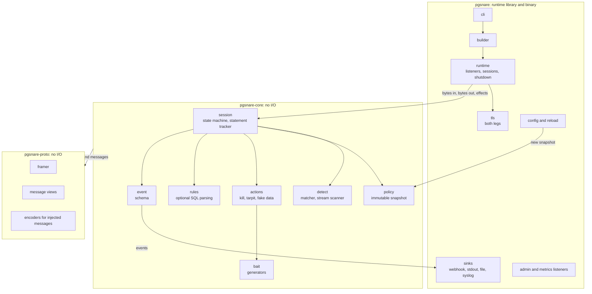
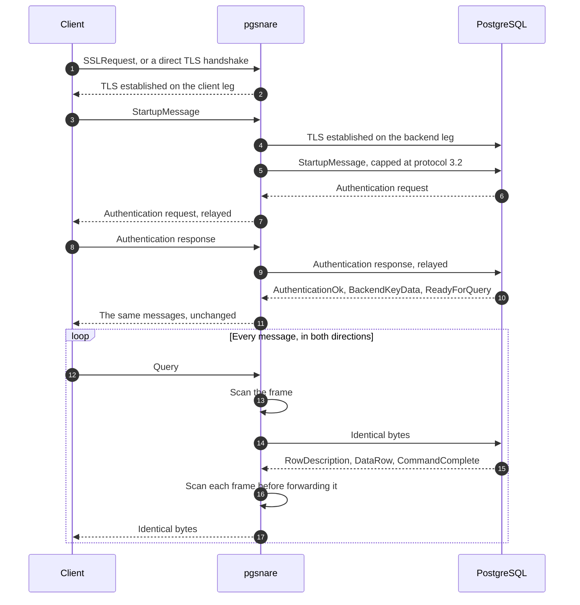
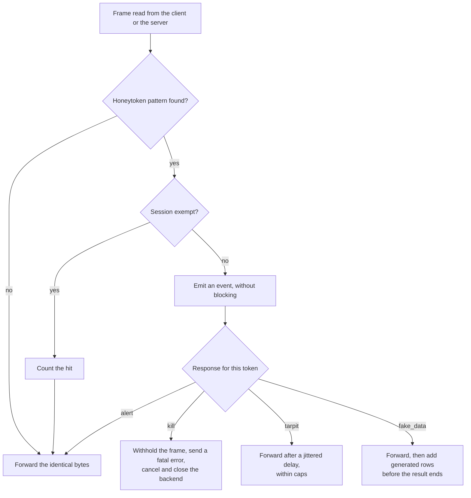
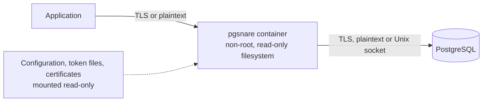
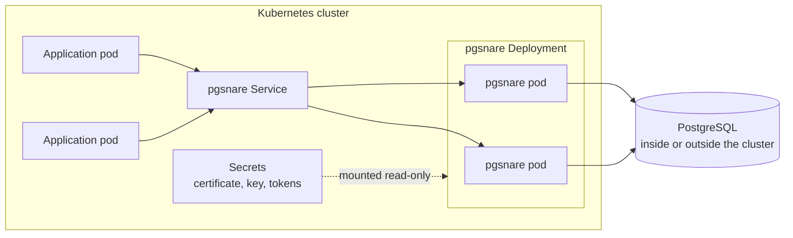
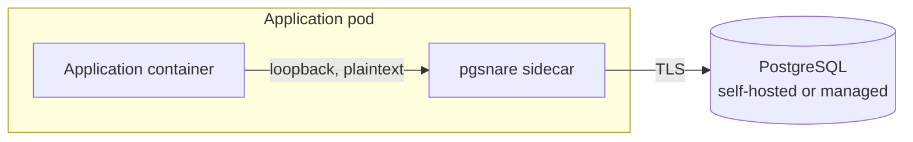

# pgsnare: high-level design

> [!NOTE]
> Status: draft. This document describes the intended design of the first version. Only part of it is implemented so far, and the [README](../README.md#status-and-roadmap) says which. Details may change as the implementation proves or disproves them.

## Contents

1. [Purpose](#1-purpose)
2. [Goals and non-goals](#2-goals-and-non-goals)
3. [Terms](#3-terms)
4. [System context](#4-system-context)
5. [Architecture](#5-architecture)
6. [Wire protocol](#6-wire-protocol)
7. [Authentication and TLS](#7-authentication-and-tls)
8. [Detection](#8-detection)
9. [Responses](#9-responses)
10. [SQL rules](#10-sql-rules)
11. [Policy, configuration and reload](#11-policy-configuration-and-reload)
12. [Events and observability](#12-events-and-observability)
13. [Extension points](#13-extension-points)
14. [Deployment](#14-deployment)
15. [Security design](#15-security-design)
16. [Quality targets](#16-quality-targets)
17. [Verification](#17-verification)
18. [Open points](#18-open-points)

## 1. Purpose

pgsnare is a proxy for PostgreSQL that detects data theft with honeytokens. It sits between applications and a real database, relays their traffic byte for byte, scans every message for honeytoken values, and responds when one appears.

This document sets out the design at the level needed to build it: the parts, how they interact, the decisions behind them, and the security requirements every part must meet. It is written for people who will implement, review or deploy pgsnare.

## 2. Goals and non-goals

### Goals

1. **Transparency.** Applications change only the host and port they connect to. Logins, TLS, prepared statements, COPY, notifications and cancellation work as they do against the database directly.
2. **Detection on data.** A honeytoken value is detected in any message, in either direction, however the query that produced it was written.
3. **Configurable response.** Each token decides what happens on a hit: alert, kill, tarpit, fake data, or a combination.
4. **No added risk.** pgsnare holds no database credentials, fails closed, and cannot be crashed or bypassed by malformed input.
5. **Supported PostgreSQL versions.** pgsnare targets the versions supported upstream, 15 to 18 today, with wire protocol 3.0 and 3.2 and direct TLS.
6. **Container-native.** It runs as a standalone container or in Kubernetes, without needing exceptions from a locked-down platform.
7. **Low overhead.** The targets are in [section 16](#16-quality-targets).

### Non-goals for the first version

- Databases other than PostgreSQL.
- PostgreSQL versions that are no longer supported upstream.
- Encryption, masking or any other change to real data.
- Connection pooling or load balancing.
- A user interface. Events go to existing tools.
- Behavioural or statistical anomaly detection.
- Detecting values that were transformed inside the database before leaving it.
- Planting honeytokens automatically. pgsnare generates them; the operator inserts them.
- A Kubernetes operator, automatic sidecar injection, or service-mesh integration.
- PROXY protocol support.
- Builds for Windows or macOS.

## 3. Terms

| Term | Meaning |
|---|---|
| Honeytoken | A fake value planted in the database that no legitimate code reads. Reading it is the signal. |
| Client leg | The connection between an application and pgsnare. |
| Backend leg | The connection between pgsnare and the database. |
| Frame | One protocol message: a type byte, a four-byte length and a body. |
| Session | One client connection paired with one backend connection. |
| Sink | A destination for events, such as a webhook. |
| Channel binding | A SCRAM feature that ties a login to the TLS certificate the client saw. |

## 4. System context


- **Applications** connect to pgsnare exactly as they would to the database.
- **An attacker** reaches the database the same way: through a vulnerable application or with stolen credentials. pgsnare cannot tell the two apart until a honeytoken is touched, and does not need to.
- **The operator** plants honeytoken rows in the database and gives pgsnare its configuration, token list and certificates.
- **Alert destinations** receive events.
- **A metrics scraper** reads counters and histograms.

One condition is outside pgsnare's control: the network must force database traffic through pgsnare. A client that can reach the database directly is not seen.

## 5. Architecture

### 5.1 Components



| Crate | Responsibility | I/O |
|---|---|---|
| `pgsnare-proto` | The wire format: framing, typed views of the messages pgsnare must understand, and encoders for the few messages it injects. | None |
| `pgsnare-core` | The session state machine, detection, policy, actions, optional SQL rules, the event schema and bait generators. | None |
| `pgsnare` | The runtime as a library with a thin binary on top: listeners, TLS, configuration and reload, the event dispatcher and its sinks, the admin and metrics listeners, the log, the redaction layer, and the CLI. | All of it |

The session logic takes bytes in and returns bytes out plus *effects*: close a connection, send a cancel request, delay, emit an event, start TLS on the client leg, open the connection to the database. The runtime carries them out and reports back what the session logic cannot see for itself: that a handshake succeeded, that the database is connected or cannot be reached, that the proxy is shutting down. The session logic never touches a socket or a clock.

The state machine of a session belongs to the PostgreSQL protocol module of `pgsnare-core`. That module is the only part of the crate that uses `pgsnare-proto`: detection, policy and events contain no PostgreSQL-specific types (see [section 13](#13-extension-points)).

This is the central structural decision. The whole session logic can be unit-tested and fuzzed with arbitrary interleavings of client and server bytes, which is how the requirement "no input can crash the proxy" is enforced rather than hoped for.

All three crates forbid `unsafe` code.

### 5.2 Path of one session



1. **Classify the first bytes.** A new connection starts with one of: a TLS handshake (direct TLS), `SSLRequest`, `GSSENCRequest`, `CancelRequest` or `StartupMessage`.
2. **Connect upstream.** On `StartupMessage`, pgsnare scans its parameters, connects to the database with TLS as configured, and forwards the startup message.
3. **Relay the login.** Authentication messages pass through unchanged in both directions. pgsnare records the cancel key the server issues.
4. **Steady state.** For each read: split into frames, scan, consult the policy, then forward, withhold or inject, and hand any effects to the runtime.

## 6. Wire protocol

**Forwarding.** A small framer locates messages. They are scanned in place and forwarded as the identical bytes. Byte-identical forwarding is both the fastest path and the strongest transparency guarantee: client and server see exactly what the other sent.

**What pgsnare rewrites or injects.** Only these:

| Message | When |
|---|---|
| `StartupMessage` | When capping the protocol version or removing protocol options |
| SASL mechanism list | In one TLS setup (see [section 7](#7-authentication-and-tls)) |
| `NegotiateProtocolVersion` | When the startup message was capped |
| `CommandComplete` row count | After adding fake rows |
| `DataRow` | Fake rows |
| `ErrorResponse` | The `kill` response, a session closed at shutdown, and a client refused before it has logged in |

**Versions.** Protocol 3.0 and 3.2 are relayed. They differ in one thing: the cancel key is 4 bytes in 3.0 and 1 to 256 bytes in 3.2. pgsnare reads the key by its length, so both work.

**Negotiation is capped at what pgsnare understands.** A startup message asking for a minor version above 3.2, or carrying protocol options pgsnare does not know, is forwarded as 3.2 without those options, and the client is told through `NegotiateProtocolVersion`. Client and server can therefore never agree on a format pgsnare cannot parse.

- pgsnare knows no protocol option today, so every `_pq_.` parameter is removed.
- A startup message that needs no capping is forwarded as the bytes that arrived.
- If the server answers a capped message with a `NegotiateProtocolVersion` of its own, the options pgsnare removed are added to it. If the server accepts the capped message without a word, pgsnare sends the `NegotiateProtocolVersion` itself, ahead of the server's first message, which is where a server puts it.
- Either way the client receives the answer the server gives when it is asked directly. The tests compare the two for PostgreSQL 15 to 18.

**Cancellation.** A `CancelRequest`, with any key length, is forwarded verbatim to the database on a fresh connection. Keys are never rewritten, so pgsnare keeps no lookup table and any replica can forward a cancel for any session.

- A `CancelRequest` is accepted in plaintext even on a listener that requires TLS, as the server accepts it, because clients older than libpq 17 send it that way. The connection that carries it to the database uses TLS as the listener is configured.
- Like the server, pgsnare answers nothing. It closes the client's connection once the database has closed its own, so a client that waits for that learns when the request has been dealt with.

**TLS negotiation.** Both styles are accepted: `SSLRequest` followed by a handshake, and direct TLS, which requires the `postgresql` ALPN as the server itself does. `GSSENCRequest` is declined. After an `SSLRequest`, any plaintext already buffered is rejected on both legs. This closes the injection flaw PostgreSQL fixed as CVE-2021-23214 and CVE-2021-23222.

- On the client leg, bytes that arrive together with an `SSLRequest` end the connection before anything is answered.
- On the backend leg, pgsnare reads exactly one byte in answer to its own `SSLRequest`. Whatever follows that byte is read by the handshake, so it can never be taken for a message from the database.
- A client that names other ALPN protocols and not `postgresql` is refused, after an `SSLRequest` as well as with direct TLS, and whatever the version of the database. PostgreSQL 17 and 18 refuse such a client too, with the alert `no_application_protocol`. PostgreSQL 15 and 16 ignore the ALPN extension and accept it. From pgsnare, the client receives the same alert with TLS 1.2. With TLS 1.3 its connection is closed in the middle of the handshake, without the alert.

**Unknown messages** are framed generically, scanned and passed through. A startup phase that cannot be parsed ends the connection. So does a login that cannot be followed: the failure policy applies only once the database has accepted the login (see [section 15.2](#152-secure-defaults)).

**Stricter than the server in three places.** pgsnare rejects a startup packet whose last byte is not zero, and an `SSLRequest` or `GSSENCRequest` that is not exactly eight bytes long. PostgreSQL accepts both. In front of PostgreSQL 15 or 16, pgsnare also refuses the TLS client that names ALPN protocols and not `postgresql`, which those two versions accept. A client that follows the protocol documentation sends none of the three, and refusing the connection is the safe way to fail.

**Limits.** Every size or count taken from the network is bounded: the startup packet (10 kB, PostgreSQL's own limit), a message before the database has accepted the login (65,535 bytes, PostgreSQL's own limit for a client that has not logged in), frames held in memory, connections per listener, and the time allowed before login. A frame above the size that is held is passed on in chunks as it arrives (see [section 8.3](#83-buffering-and-streaming)), so the memory a session needs does not depend on the size of a message.

**What a client is told when pgsnare ends a connection.** pgsnare speaks with the codes and the texts of PostgreSQL's own errors, so that a client sees nothing specific to pgsnare:

| Situation | What the client receives |
|---|---|
| The proxy shuts down and the grace period is over | `57P01`, "terminating connection due to administrator command" |
| The database cannot be reached, or its certificate does not verify | `57P03`, "the database system is not accepting connections", the code of a server that cannot take connections at the moment |
| A plaintext client on a listener that requires TLS | `28000`, with the text PostgreSQL uses when its access rules admit encrypted connections only |
| A listener at its connection limit, a client that takes too long to log in, a startup phase or a login that cannot be parsed | The connection is closed without a message |

## 7. Authentication and TLS

pgsnare relays logins and never terminates them. It does not know any password and holds no database credentials. TLS, by contrast, is terminated on both legs, because pgsnare must read the traffic.

This combination has one consequence that shapes deployment. SCRAM channel binding ties a login to the server certificate the client saw, and the server detects both a mismatch and a downgrade. A relay that does not know the password cannot get around either check.

The integration tests try every row of this table against PostgreSQL 15 to 18 with a libpq 18 client. A row that fails is checked for the failure named here.

| Client leg | Backend leg | What pgsnare does | Result with default client settings |
|---|---|---|---|
| TLS, presenting the database's own certificate and key | TLS | Relays the login unchanged | Works, including `channel_binding=require` |
| TLS, pgsnare's own certificate | Plaintext or Unix socket | Relays unchanged | Works. `channel_binding=require` fails, because there is nothing to bind to |
| Plaintext | TLS | Removes `SCRAM-SHA-256-PLUS` from the server's offer | Works |
| Plaintext | Plaintext | Relays unchanged | Works |
| TLS, pgsnare's own certificate | TLS | Relays unchanged | Fails for clients that use channel binding, which libpq does by default: the database reports that the channel binding check failed. Works only with `channel_binding=disable` |

Supported setups, in order of preference:

1. **Shared certificate.** pgsnare is given the database's certificate and key. Clients cannot tell the difference and channel binding keeps working.
2. **Next to the database**, with a plaintext or Unix-socket backend leg.
3. **Next to the application**, with a plaintext client leg and TLS to the database. This suits managed databases that enforce TLS and do not hand out the server key.

In the third setup pgsnare removes every mechanism whose name ends in `-PLUS`, which is how the SCRAM family marks channel binding. Today that is `SCRAM-SHA-256-PLUS`. A client without TLS cannot use such a mechanism, and libpq ends the login when it is offered one.

When both legs use TLS, pgsnare compares its client-leg certificate with the one the database presents and logs a clear warning at startup if they differ. The certificates are compared in their encoded form. When the database cannot be reached at startup, pgsnare says so and starts all the same, and the warning then comes with the first connection to the database.

On the backend leg, `verify-full` checks that the certificate of the database chains to a configured authority, or to the system's certificate store, and that it carries the name of the database among its subject alternative names. The common name of a certificate is not looked at. The modes `prefer` and `require` encrypt and do not verify, and pgsnare says so in its log when it starts.

Not supported in the first version: login with client certificates, GSSAPI encryption, and a central proxy with TLS on both legs in front of a database whose key is not available. Those require pgsnare to terminate authentication itself.

## 8. Detection

### 8.1 Tokens and patterns

- A token is one or more values with an id, an optional scope hint used only for reporting, and its response.
- Values must be ASCII and at least 12 bytes. Matching then does not depend on the client's character encoding, and accidental matches are implausible.
- Each value compiles to a small set of byte patterns: the raw value, its lowercase hex form (how `bytea` is printed in text format) and, if requested, a case-insensitive variant.
- A token list in which data matching one value would also match another is rejected. That covers a value used twice and a value that contains a pattern of another. Every match then belongs to exactly one token. The loader of the configuration applies this rule, so a configuration that loads is one the matcher compiles.
- The values pgsnare generates follow these rules by construction: see [section 9.1](#91-bait).
- All patterns are matched in one pass with the Aho-Corasick algorithm.

### 8.2 What is scanned

Every message body, in both directions.

- **From the server:** result rows and COPY data, and also error and notice text, notification payloads, parameter status values and function-call results. Error text matters because error-based SQL injection leaks values through it.
- **From the client:** query text, bind parameters, COPY data and startup parameters. A honeytoken used as a database user name therefore fires at login, and a stolen honeytoken value fires when someone uses it in a query.

Because matching works on substrings of raw bytes, a value is found inside JSON, arrays, composite rows, aggregated strings and COPY output with no special handling.

### 8.3 Buffering and streaming

- A message up to `max_buffered_frame` (default 1 MiB) is scanned whole before any byte of it is forwarded. This is what lets `kill` withhold the row that contains the token.
- A larger message is scanned as a stream. The last bytes of each chunk are carried over, so a value split across chunks is still found, and the message is forwarded chunk by chunk. For such a message, bytes that come before the token inside the same message can reach the client.
- Whole results are never buffered. Memory use is bounded whatever the result size.

### 8.4 Detection does not depend on state

Detection is stateless per message, with one exception: the messages of one COPY in one direction are read as a single stream, so that a value split across two `CopyData` messages is found. Other messages are never joined.

Knowing which statement produced a row is the job of a statement tracker, and it only enriches the event. It follows the simple and the extended protocol, with pipelining, error recovery and COPY, and reads no SQL. It is bounded for each session: 256 waiting messages, 256 statements, 64 portals and 256 KiB of statement text. If tracking loses sync, the event reports the query as unknown and the hit is still raised. A hit in `CopyDone`, in `CopyFail` and in a function call is also reported without a statement. A statement that an SQL command prepares or deallocates is not followed. SQL parsing is never on the detection path.

### 8.5 Decision flow



The diagram shows one response per hit for clarity. A token can combine several.

### 8.6 Known gaps

Result inspection cannot see everything, and the documentation must say so.

- **Transformed values.** A value hashed, cut, re-encoded or encrypted inside the database before it leaves does not match. Planting several tokens across several columns reduces the exposure.
- **Blind extraction.** Boolean or time-based SQL injection infers data without ever returning it. The optional SQL rules can flag the functions such attacks rely on.
- **Rows already sent.** `kill` withholds the row containing the token, not the rows that preceded it in the same result. Token placement matters.
- **Bypass.** Traffic that does not pass through pgsnare is not seen.
- **Honeytokens used as a password.** Login messages (the password a client sends, in cleartext, as md5 or in a SASL exchange) are not scanned, so a honeytoken that an intruder sends as a password is not detected. A honeytoken used as a user name is, because the startup message is scanned, and so is one used in a query. This is a known limit and it is not hidden; looking for alternatives is future work (see the README).

## 9. Responses

| Response | Behaviour |
|---|---|
| `alert` | Emit an event. The session continues. This is the default. |
| `kill` | Withhold the matching message. Send the client a `FATAL` error that looks like an administrator terminating the session (SQLSTATE `57P01` by default) and close the connection. Then send a cancel request with the session's own key and close the backend connection. No database credentials are needed. |
| `tarpit` | Delay each flush to the client by a jittered interval, with an optional rate cap. A tarpitted session keeps a real database connection busy, so it is bounded by a maximum duration and a maximum number of tarpitted sessions. Past either limit, the session is killed. |
| `fake_data` | Insert generated rows before the end of the result and adjust the reported row count. Rows are built by recombining values sampled from the real rows of that result, with generated bait in credential-like columns. This needs a text-format result with a known row description; otherwise it falls back to `alert`. |

- **Combination and escalation.** A token can list several responses, and can replace them by others from the n-th hit of that token in the same session. `kill` overrides `tarpit` and `fake_data` in the same set. A response that cannot be carried out becomes `alert`. A session that hits more than 1,024 different tokens gets the escalated response for every further token.
- **Flagged sessions.** Once a session has triggered, each later statement emits a `session_activity` event, giving a timeline of what the session did next.
- **Exemptions.** Hits from a listed database user or client address range are counted and trigger nothing. Without this, a backup, a replica or an ETL job that reads whole tables through pgsnare would fire every time. Address-based exemptions are only as trustworthy as the address pgsnare sees; see [section 14.5](#145-scaling-and-client-addresses). A user exemption applies only once the database has accepted the login, because until then the name is only the client's claim; `application_name` and other client fields never exempt; `SET ROLE` does not change an exemption. When an entry names a user and a range, both must match. An exempt hit raises no event.

How the responses behave in the code:

- **`kill`** withholds the message and every hit in it is raised first. The error has the fields and the order of the error the session writes when the proxy stops, without the file, line and routine fields. The cancel request is sent before the queued bytes are flushed. When the client has already received part of the message, both connections close without an error. At login the answer is sent before the database is reached.
- **`tarpit`** makes one delay for each read from the database that queued bytes for the client, uniform in the `delay` range, and longer if `max_bytes_per_second` asks for it; if the random source fails, the longest delay is used. While the session is held nothing more is read from the database, and no buffer grows. The limit on sessions is global, and a session keeps its place until it ends. Past the limit on sessions or on time, the session is killed, and the event says `kill`. The settings are those of the snapshot at the first tarpit hit of the session.
- **`fake_data`** is decided when the hit is reported, and applies only when the hit is in a server `DataRow`, the portal's `RowDescription` is known, all columns are text, there are at most 256 columns, the statement is one `SELECT`, `TABLE` or `VALUES`, and no `Execute` with a row limit has been seen in the session. Otherwise the event reports the fallback (`alert`). Samples come only from rows without a match, at most 32 samples of at most 1 KiB per field and 64 KiB in all; at most 8 MiB are added. Generated rows are scanned with the matcher before they are sent. Rows are appended at the end of the result, and the command tag is raised. If at the end rows cannot be added (a tag that is not `SELECT n`, a column with no clean sample, a random source that fails), the result goes on unchanged though the event said `fake_data`. Unlisted text columns recombine samples, so a unique text column can repeat a value.

### 9.1 Bait

Bait is a made-up value of a kind an intruder looks for. `pgsnare token generate` prints bait to plant as honeytokens, and the `fake_data` response puts bait into the rows it adds. Both use the same generators.

| Kind | Value |
|---|---|
| Account | The name of a made-up service account, such as `svc.backup.` and twelve random characters, and its email address at a domain the operator supplies |
| bcrypt | `$2a$12$` and 53 characters |
| Argon2id | `$argon2id$v=19$m=65536,t=3,p=4$`, a salt and a hash |
| SCRAM-SHA-256 | A verifier as PostgreSQL stores one: `SCRAM-SHA-256$4096:`, a salt, a stored key and a server key |
| API key | 40 letters, digits, `-` and `_` |
| Card number | 16 digits that begin with `99` and end with a Luhn check digit |
| Marker | Four groups of four upper-case letters and digits, to put into free text |

- **Every value is a valid honeytoken.** It is ASCII, at least 12 bytes long, and made of characters that none of the text formats of PostgreSQL escapes, so it is found wherever it is printed.
- **Every value is new.** All of its randomness comes from the secure random generator of the operating system. If that fails, no value is made. Nothing makes the values predictable: there is no seed, as an option, in the environment or in the build.
- **A hash is the hash of nothing.** It has the exact format of its kind, and random bytes where a real hash holds what was computed. No password belongs to it.
- **No real person, domain or service.** An account name is made of ordinary words, an email address uses the domain of the operator, and an API key carries no prefix of a service that exists.
- **A card number is kept away from the numbers of real cards.** No range of card numbers that is reserved for testing was found. The numbers stay out of the ranges of the payment schemes instead. The first digit of a card number names an industry, and the digits that include banking and finance are 2 to 6. These numbers begin with `99`. The digit 9 is left to national standards bodies, and what they assign continues, as far as could be found out, with a country code, of which none begins with 9. Whoever looks at the first digit can tell that such a number is not a payment card. See [section 18](#18-open-points).

An account is one value in the configuration: its name. The email address contains the name, so data from either column sets the token off.

## 10. SQL rules

Rules are optional. They flag suspicious statements before any data is read:

- catalogue enumeration by application users
- unbounded reads of tables marked sensitive
- results above a row threshold on those tables
- functions that read files or run programs

How they are built:

- Statements are parsed with the PostgreSQL 18 grammar through the `pg_query` library, which embeds PostgreSQL's own parser.
- The parser is C code that receives attacker-controlled input, so it is isolated. It sits behind a build feature, runs on a dedicated thread pool, has an input size cap, and is never on the detection path. A build without the feature does not contain the parser.
- A statement that fails to parse follows a configured policy: allow, alert or block. It is never silently ignored.
- Verdicts are cached by a hash of the statement text.

## 11. Policy, configuration and reload

- **Snapshot.** Tokens, compiled patterns, exemptions, response settings and the query redaction mode form one immutable snapshot (the SQL rules will join it; they are future). A reload builds a new snapshot off the data path, with the file permission check and the matcher, and swaps it in with one write of a lock-protected pointer. A session reads it once for each message; a COPY or a streamed message keeps the matcher it started with until it ends. An invalid file keeps the old snapshot, writes a log line that names the file and the reason, and counts in `pgsnare_reload_failures_total`.
- **Reload triggers.** `SIGHUP`, or a change to the configuration file, its directory, or the directory of a token-file pattern, which includes the atomic symlink swap Kubernetes uses for mounted volumes. The watcher polls each second and reloads once nothing has changed for a further second. Only the policy is reloaded. Listeners, TLS, sinks, the admin and metrics listeners and the grace period need a restart, which a reload that changes them says in the log.
- **What a reload does to sessions.** None is dropped. A flagged session stays flagged, also if it becomes exempt. What redaction removes grows with the new tokens before the swap, and the values of removed tokens are no longer removed.
- **One YAML file**, with honeytoken values optionally in separate files so they can be stored as a secret.
- **Secrets** such as webhook signing keys come from environment variables or files, never from the configuration body.
- **File permissions.** pgsnare refuses to start if a private key, a token file, the configuration file, or a file from which a webhook sink reads its signing key or its URL is open to other users, unless explicitly overridden. The rule is PostgreSQL's own: a file owned by the process user must not be readable by group or others, and a root-owned file may be group-readable. A file owned by anyone else is refused. The override is the option `--allow-insecure-file-permissions` of `pgsnare run`, and every file it lets through is named in the log. `pgsnare config check` takes the same option, and then reports such a file as a warning.

The format is strict: an unknown field is an error, at least one sink is required, and a webhook sink must name its signing key.

The sketch below shows the shape. The complete reference is [`examples/config/pgsnare.yaml`](../examples/config/pgsnare.yaml), which lists every setting with its default and is loaded by the tests.

```yaml
listeners:
  - name: main
    listen: 0.0.0.0:5432
    upstream: db.example.com:5432        # or unix:/var/run/postgresql/.s.PGSQL.5432
    client_tls:   { mode: require, cert: /etc/pgsnare/server.crt, key: /etc/pgsnare/server.key }
    upstream_tls: { mode: verify-full, ca: /etc/pgsnare/root.crt }

inspection: { on_error: fail_closed, max_buffered_frame: 1MiB }

token_files: ["/etc/pgsnare/tokens/*.yaml"]          # for example a mounted secret
tokens:
  - id: users-admin-backup
    values: ["svc.backup.8f3k2q@mail.example"]
    scope: { database: app, table: public.users }    # reporting hint only
    actions: [alert, kill]
    escalate: { after_hits: 3, to: [kill] }

exemptions:
  - { db_user: backup, client_cidr: 192.0.2.5/32 }   # nightly backup

actions:
  tarpit: { delay: 2s-30s, max_duration: 10m, max_sessions: 50 }
  fake_data: { rows: 500 }

events:
  query_redaction: fingerprint                       # full | fingerprint | none
  dedup_window: 60s
  labels_from_env: [POD_NAME, POD_NAMESPACE]         # instance labels on every event
  sinks:
    - { type: webhook, url: "https://alerts.example.com/hooks/pgsnare", hmac_secret_env: PGSNARE_WEBHOOK_SECRET }
    - { type: stdout }

admin:   { listen: 127.0.0.1:9641 }                  # health, loopback only
metrics: { listen: 127.0.0.1:9642 }
```

### 11.1 Commands

| Command | What it does |
|---|---|
| `pgsnare run` | Runs the proxy |
| `pgsnare config check` | Checks a configuration and reports every problem |
| `pgsnare token generate` | Makes honeytokens, and prints the SQL that plants them and the token file that matches |
| `pgsnare token list` | Lists the honeytokens of a configuration, without their values |
| `pgsnare token test` | Says whether a value matches a honeytoken of a configuration |
| `pgsnare healthcheck` | Asks a running proxy whether it is healthy |

**`config check`** uses the code of `run`: the same loader, the same rule for the access rights of the same files, the same functions to read certificates and keys, and the same code to build the sinks. A configuration that passes starts, and one that fails does not, as far as that can be known without connecting to anything, opening a listener or writing a file.

- It reports every problem it can find in one run: unknown fields, honeytokens that are not valid, files that are missing or open to other users, and sinks that cannot be built, such as a webhook whose signing key is not there or whose URL cannot be used.
- It warns about settings that are valid and give up some protection: a database whose certificate is not verified, `fail_open`, a sink over plain HTTP, an admin or metrics listener beyond loopback, a signing key shorter than 32 bytes, and a file for events that other users can read.
- It reads the files and the environment variables that the configuration names, the signing key of a webhook among them. It therefore says what `run` would do on the same machine, as the same user and with the same environment.
- It creates no file. For a `file` sink whose file is not there yet, it asks whether the directory would take one.
- `run` can still fail after a check that passed: when the address of a listener, the admin and metrics listeners included, is taken or is not an address of the machine, and when the file of a `file` sink cannot be created after all. A database, a webhook receiver or a syslog server that does not answer does not keep `run` from starting. It shows with the first connection or the first event.
- Any error gives a non-zero exit status. Warnings alone do not.

**`token generate`** connects to nothing and writes nothing but its output. It prints one SQL script: an `INSERT` with a row for each honeytoken, and the token file for pgsnare inside an SQL comment. The operator reviews it, runs it, and gives the token file to pgsnare.

- Names and values are quoted for the place they are printed in, so that no name of a table or a column can end the statement or begin another. A name with a control character is refused.
- The script is plain ASCII whatever the names are made of. A name outside ASCII is written with the code points of its characters, so that the script reads the same in every client encoding.

**`token list` and `token test`** never show the value of a honeytoken.

- `token list` shows ids, scopes, responses, and how many values a token has.
- `token test` reads a value from standard input, so that the value does not end up in the shell history or the process list. A terminal is refused, because what is typed there is shown. The command answers with the id of every token the value matches, and scans its input the way traffic is scanned.

## 12. Events and observability

What this section describes is built, except where it says otherwise. Nothing detects yet, so the only event that real traffic raises today is `inspection_bypassed`. The hits in the tests of this section are made by the tests.

### 12.1 Events

Events are versioned JSON objects.

| Group | Fields |
|---|---|
| Identity | `schema_version`, `event_id`, `timestamp`, `kind`, `session_id`, instance labels |
| What fired | `token_id` or `rule_id`, `action_taken`, `hit_count`, `direction`, `message_type` |
| Who | `client_ip`, `client_port`, `db_user`, `database`, `application_name`, `tls` |
| Context | `query` (redacted as configured), `rows_so_far`, `session_flagged` |

Event kinds are `token_hit`, `rule_hit`, `parse_failure`, `session_activity` and `inspection_bypassed`.

- **Token values never appear** in events, logs or metrics; only token ids do. Passwords and key material are never logged. Bind parameters are never part of an event.
- **The statement of an event** follows `events.query_redaction`. `full` shows the text, cut at 4,096 bytes. `fingerprint`, the default, shows the SHA-256 hash of the text as it was sent, constants included. `none` shows nothing. A reader of events who knows a statement except for a short constant in it can try every value against a fingerprint. The plan is that a build with the SQL parser leaves constants out of the fingerprint. Until then, `none` is the mode that tells nothing. The function that applies the mode exists and is tested, and nothing raises an event with a statement yet.
- **Instance labels** come from `events.labels` and from the environment variables that `events.labels_from_env` names. A variable that is not set, or whose value is empty, too long or contains a control character, gives no label, and pgsnare says so in its log.
- **Identifiers.** `event_id` and `session_id` are 128 bits from the secure random generator of the TLS library. They tell events and sessions apart, and they are not secrets: nothing is granted to whoever knows or guesses one. Should that generator ever report a failure, an identifier is made from the clock and a hash instead, which is enough to tell two of them apart and would not be enough for a secret.

### 12.2 From a session to a sink

- **A session never waits.** It puts an event into a queue of fixed length (`events.queue_size`, 1,024 by default) and goes on. It takes no lock. When the queue is full, the event is dropped and counted.
- **The dispatcher** takes events from that queue in a task of its own. It removes what must not be shown (see [section 12.6](#126-logs-and-redaction)), folds repeated hits, seals the event with an identifier, the time it was raised and the instance labels, and puts it into the queue of every sink. A sink whose queue is full loses that event, which is counted, and the other sinks still get it.
- **Deduplication.** The first hit of a token in a session is delivered at once. Later hits of the same token in the same session within `events.dedup_window` (60 seconds by default; `0s` turns it off) are folded: they are not delivered, and when the window closes, one event reports the last of them with their number as its `hit_count`. A hit that was answered with other responses is delivered at once. Only `token_hit` events are folded. At most 4,096 windows are open at a time, and a hit that would need one more is delivered as it is.
- **Room for hits.** A quarter of the queue of each sink is kept for `token_hit` and `rule_hit` events: another kind of event is accepted only while more than that many places are free. A queue of fewer than four places keeps none. The queue in front of the dispatcher keeps no such room.
- **Each sink has a worker** with a queue of its own (`queue_size`, 1,024 by default), an optional rate limit (`max_events_per_second`), a time limit for each attempt and retries. A failed attempt that may succeed later is made again after a pause that starts at 250 ms and doubles up to 30 seconds, shortened at random by up to half. When the retries are used up (`max_retries` for a webhook, 5 for the other sinks), the event is dropped. A sink that refuses an event for good is not asked again. A panic in a sink ends one attempt.
- **When the proxy stops**, the sinks get 2 seconds to deliver what waits. What is left is dropped.

Every drop is counted in a metric, by sink and by reason. A sink that is slow, down or never answers costs events and never a delayed query.

### 12.3 Sinks

The four sinks implement the public sink interface (see [section 13](#13-extension-points)). A sink makes one attempt to deliver one event. Queueing, the rate limit, the retries and the counting are the dispatcher's, for every sink alike.

| Sink | What it does with an event |
|---|---|
| `webhook` | Posts it as a signed request over HTTPS |
| `stdout` | Writes it to standard output as one line of JSON. Standard output carries nothing else: the log goes to standard error |
| `file` | Appends it to a file as one line of JSON |
| `syslog` | Sends it as one message in the format of RFC 5424 |

**Webhook.**

- **HTTPS, verified.** The certificate of the receiver must chain to an authority of the system's certificate store and carry the host name of the URL. TLS 1.2 is the floor. A plain `http` URL is refused unless the sink sets `allow_insecure_http`, and pgsnare then says in its log that events travel unencrypted.
- **One request for each attempt**, as an HTTP/1.1 `POST` on a connection of its own. No redirect is followed, and no proxy is used, whatever the environment says.
- **Limits.** An attempt has `timeout` (5 seconds by default) from resolving the name to the end of the answer. The head of the answer may have 16 KiB, and at most 64 KiB of its body are read, and thrown away.
- **The answer.** A `2xx` status means delivered. `408`, `425`, `429` and `5xx` mean not now, and the attempt is made again later. Any other status, a redirect included, drops the event.
- **The signing key** comes from an environment variable or a file, never from the configuration. At most 4,096 bytes are read, and one line break at the end of a file is not part of the key. The bytes that were read are wiped once the cryptographic library holds the key. A key shorter than 32 bytes is used, with a warning. The value of an environment variable stays in the environment of the process for as long as it runs; a file does not.
- **The URL** can come from an environment variable or a file too, because some webhook URLs are secrets. Neither the URL nor the key is part of any log line or error.

Every request carries three headers:

| Header | Content |
|---|---|
| `x-pgsnare-timestamp` | The time of the attempt, in seconds since 1970-01-01T00:00:00Z, as decimal digits |
| `x-pgsnare-signature` | `v1=` and 64 lowercase hexadecimal digits: the HMAC-SHA256, with the key of the sink, of the timestamp as it stands in its header, one full stop (the byte `0x2e`) and the body, byte for byte |
| `x-pgsnare-event-id` | The `event_id` of the body, as a convenience. It is not signed |

Nothing has to be parsed to check a signature. A receiver must do four things:

1. Reject a request without both headers, with a timestamp that is not a decimal number, or with a signature that is not `v1=` and 64 hexadecimal digits.
2. Reject a request whose timestamp is further from its own clock than it tolerates, five minutes for example. A recorded request cannot be sent again later.
3. Compute the HMAC over the timestamp, the full stop and the body as received, and compare it with the signature in constant time. Whoever does not hold the key cannot make a signature that matches.
4. Remember the `event_id` of the body of every request it accepted, for as long as it tolerates old requests, and reject a repetition. Without this, a recorded request passes the first three checks until its timestamp is too old.

A retry carries the same event and `event_id` under a new timestamp and signature. A receiver whose answer was lost sees the event twice, and the fourth check also makes that harmless.

**File.**

- The file is created with mode `0600`. A file that is there keeps its mode, and pgsnare says in its log when others than the owner can read or write it.
- If the last part of the path is a symbolic link, the file is not opened. Only a regular file is written to. The directories on the way are the operator's to protect.
- **Rotation.** Before each event the sink looks at what the path leads to. After a rename or a removal, the next event goes to a new file at the path, which the sink creates if nothing else has. After the file was emptied in place, the sink goes on at its new end. Nothing has to tell pgsnare.
- A write that fails is tried again like any failed delivery. If only a part of a line reached the file, the next write starts with a line break, so that the broken line does not run into the next event.

**Syslog.**

- The message is `<PRI>1 TIMESTAMP HOSTNAME pgsnare PROCID MSGID - MSG`. `MSGID` is the kind of the event, there is no structured data, and `MSG` is the event as JSON. The facility comes from the configuration (`local0` by default). The severity is 1 (alert) for `token_hit`, 4 (warning) for `rule_hit` and `inspection_bypassed`, and 5 (notice) for the other kinds.
- **An event cannot forge a record.** Nothing of an event goes into the header. `MSG` is printable ASCII from its first byte to its last: the JSON encoder escapes control characters, and the sink writes every character outside ASCII as an escape too. No text of an event, such as a user name with a line break in it, can end a record and begin another.
- **Transport.** Over UDP, or a datagram socket of the system such as `/dev/log`, one message is one datagram, as RFC 5426 requires, and an event that does not fit into a datagram is dropped. Over TCP, or a stream socket of the system, each message is preceded by its length and a space, the octet counting that RFC 6587 describes. The connection is kept between events and opened again when it fails.
- **What syslog does not give.** A message is not encrypted. A syslog server sends no answer, so an event that was written to a connection the server has just closed is lost without the sink knowing. And a message is as long as its event: RFC 5424 obliges a receiver to accept 480 bytes and recommends 2,048, and allows it to cut or drop what is longer. An event with long names is longer than that, and one that shows a statement in full can exceed 4,096 bytes, so the limit of the receiver has to be set for it. Where a delivery must be confirmed, the webhook sink is the one that gets an answer.

### 12.4 Metrics

Metrics are served on a listener of their own (`metrics.listen`, `127.0.0.1:9642` by default) at `/metrics`, in the text format of Prometheus. pgsnare writes that text itself from its counters.

| What | Metrics |
|---|---|
| State | `pgsnare_build_info`, `pgsnare_ready`, `pgsnare_healthy` |
| Connections | `pgsnare_connections_accepted_total`, `pgsnare_connections_refused_total`, `pgsnare_connections_active`, `pgsnare_sessions_failed_total`, `pgsnare_logins_total`, `pgsnare_login_timeouts_total`, `pgsnare_backend_connection_failures_total`, `pgsnare_cancel_requests_forwarded_total` |
| Bytes | `pgsnare_bytes_total` by direction, `pgsnare_read_buffer_bytes` |
| Events | `pgsnare_events_raised_total`, `pgsnare_events_total` by kind, `pgsnare_events_deduplicated_total`, `pgsnare_event_queue_depth`, `pgsnare_event_queue_capacity`, `pgsnare_events_dropped_total` |
| Sinks | `pgsnare_sink_queue_depth`, `pgsnare_sink_queue_capacity`, `pgsnare_sink_events_delivered_total`, `pgsnare_sink_delivery_attempts_failed_total`, and `pgsnare_sink_events_dropped_total` by reason, each by sink |
| Faults | `pgsnare_panics_total` by where the panic happened, `pgsnare_listener_failures_total` |
| Added latency | The histogram `pgsnare_added_latency_seconds`: the time bytes spend in the proxy once a client has logged in, from reading something from one connection to having written everything that came of it to the other |
| Detection and responses | `pgsnare_queries_total` (`Query`, `Execute` and function calls), `pgsnare_hits_total` by kind (`token`, `token_exempt`, `rule`), `pgsnare_token_hits_total` by token and exemption, `pgsnare_actions_total` by response (what was carried out), `pgsnare_reload_failures_total` |
| No source yet | `pgsnare_rule_hits_total` and `pgsnare_parse_failures_total`. They are exported and say zero until the SQL rules are built (future) |

- **Labels are bounded.** A label value is a fixed word of the code, the name of a sink, which is its type and its place in the configuration, such as `webhook-0`, or the id of a token or a rule from the configuration. It passes through the redaction layer, keeps only ASCII letters, digits and `.`, `_`, `:`, `-`, and is cut at 128 bytes. Nothing a client or a database sent becomes a label or part of a name.
- **No list of tokens.** A token gets a series of its own only once it was hit, and by then its id has been in an event.

### 12.5 Health

The admin listener (`admin.listen`, `127.0.0.1:9641` by default) serves two paths:

| Path | Answer |
|---|---|
| `/healthz` | `200` while the proxy works as it should, `503` once one of its listeners has failed |
| `/readyz` | `200` while the proxy accepts clients, `503` before that, while it stops, and once a listener has failed |

The admin and the metrics listener have the same limits and the same rules:

- **Read-only.** They answer `GET` on their paths and nothing else: another method gets `405`, another path `404`. They show a state and numbers: no configuration, no address of a client and no list of tokens.
- **Plain HTTP, without a login.** Both are bound to loopback by default. When one is given another address, whoever can reach it can read what it serves, and pgsnare says so in its log when it starts.
- **Limits.** One request for each connection. A connection has 10 seconds in all, so a client that sends nothing, sends slowly, never stops sending or does not read its answer is dropped. The head of a request may have 8,192 bytes and 64 headers, and its body is never read. A listener holds at most 32 connections, and one more is closed at once.
- **When they fail.** An address that cannot be opened keeps the proxy from starting. A panic while a request is answered ends that connection. A panic in the loop that accepts connections ends the loop, which is started again after a moment. Both are counted and logged. Database traffic does not depend on either listener.

`pgsnare healthcheck` asks the admin listener: see [section 14.2](#142-lifecycle).

### 12.6 Logs and redaction

**The log** goes to standard error, one JSON object for each line, with `timestamp`, `level`, `message` and the fields of the line.

- The message and the names of the fields are fixed texts of the code. The values are counts, addresses of sockets, and names and paths from the configuration. Nothing a client or a database sent is written to the log, and neither is a secret. That is a rule for every line of code that logs.
- Two things do not depend on that rule being kept. Every text of a line passes through the redaction layer. And every line is written by the JSON encoder, so a value with a line break or a quotation mark in it is still one field of one line.
- The log is written by a thread of its own. A session hands a line to a queue of at most 1,024 lines and 1 MiB and goes on; when the queue is full the line is dropped and counted, so a stalled standard error costs lines and never makes a session wait. At exit the process waits up to 2 seconds for the queue. If the thread cannot be started, lines are written directly.
- A text is cut at 4,096 bytes and a line has at most 32 fields. A panic is logged with the place it happened and without its message.

**Redaction** is one module that everything passes through before it leaves the process: the dispatcher gives it every event before any sink sees it, the log gives it every text of a line, and a name becomes a metric label through it and in no other way.

- **What it removes.** Honeytoken values in every form the matcher finds them in: as written, as lowercase hexadecimal digits and, for a token that asks for it, in any letter case. The patterns are the matcher's own, so what detection finds, redaction removes. It also removes the beginning of a value where a name was cut inside it, and the URL of every webhook. Each is replaced by `[redacted]`. If the search itself fails, nothing of the text is shown.
- **What it does not look for.** Key material: a signing key and a private key are handed to the cryptographic library, and no error, log line or event is built from them. Looking for them would mean keeping a second copy of every key. Passwords and bind parameters: pgsnare relays them without keeping them, and no event, log line or metric has a place for one.
- **Where it ends.** A value that was written in another form, such as base64, is not recognised. The rule for the code that logs stays the first protection, and the leak test of [section 17](#17-verification) searches for those forms. The URL of a webhook is known to the redaction layer once all sinks are built, and the code that builds them logs no URL.

## 13. Extension points

The public crates expose three interfaces:

- a **login strategy** (the first version ships one: relay)
- an **event sink**
- a **protocol module** boundary (the first version ships PostgreSQL)

Detection, policy and events contain no PostgreSQL-specific types. A builder assembles a proxy from these parts, so another build can add its own implementations without forking the core.

Extensions are compiled in. There is no runtime plugin loading, no dynamic libraries and no scripting, which leaves the attack surface unchanged.

## 14. Deployment

### 14.1 The container image

- One image holds the static binary, CA certificates and a non-root user, on an Alpine base pinned by digest. **The base has a shell (busybox) and a package manager.** That is the owner's choice of base: it can be pinned, scanned and updated, and it has the certificates and user files. What keeps those tools harmless is not their absence but the confinement of the process (below). Nothing in the image installs a package at run time, and the image test checks what still holds: the user is numeric and not 0, no file has the setuid or setgid bit, nothing but the home directory belongs to anybody but root, no package manager cache is left, and the binary belongs to root and cannot be written.
- The binary is static (musl), built with `--locked` and the default features; the image holds the very file that the release publishes. The user is `65532`, named by number so that Kubernetes can check it is not root. The entry point is `pgsnare`, and the health check is `pgsnare healthcheck` in exec form.
- It is built for x86_64 and aarch64, each natively. It is meant to be published to the GitHub Container Registry as `ghcr.io/guidorugo/pgsnare` and the chart as `ghcr.io/guidorugo/charts/pgsnare`, by digest. **Nothing is published yet:** no release has been made. Examples pin it by digest.
- It runs as a non-root user with no Linux capabilities and a read-only root filesystem, when started as the chart and the examples start it. The image test starts it that way.
- Built and tested in CI: see section 17. Not verified: the musl build with the optional SQL parser, which is not in the default features of the code this image was built from.

### 14.2 Lifecycle

- pgsnare runs correctly as process 1 of a container.
- **Start.** `pgsnare run` builds the sinks, opens the admin and metrics listeners, and then opens the listeners for clients. When a sink cannot be built or a listener cannot be opened, it says why in its log and exits with status 1. Until the listeners for clients are served, the proxy is healthy and not ready.
- **Stop.** On `SIGTERM` it stops accepting connections, reports not-ready, lets open sessions finish for a configurable grace period, then closes the rest with the same error the database sends on an administrator shutdown. `SIGINT` does the same. The sinks then get 2 seconds to deliver the events that wait. The health endpoints and the metrics answer until all of that is done, and a proxy that stops is healthy and not ready. It then exits with status 0.
- A session that cannot read an error at that moment is closed without one: a client that has not sent its startup message yet, or one that is in the middle of a message that is being passed on in chunks.
- **A listener that fails.** If a listener stops accepting clients while the proxy is meant to run, which takes a defect in pgsnare such as a panic in the loop that accepts them, the proxy logs an error, counts the failure, reports that it is neither ready nor healthy, and stops as it does on `SIGTERM`. The open sessions of every listener, the failed one included, get the grace period. `pgsnare run` then exits with status 1, so that whatever supervises the process starts it again. No traffic passes uninspected in either case. The point is that a proxy which serves nobody on one of its addresses must not go on reporting that it is healthy.
- **`pgsnare healthcheck`** asks `/healthz` of the admin listener and exits 0 or 1. With `--ready` it asks `/readyz`. It writes nothing on success and one line to standard error on failure, and it needs nothing but the binary, so it works in an image without a shell.
  - It asks the address that the configuration given with `--config` names for the admin listener, or the default address. A listener that is bound to every address is asked over loopback. No option takes an address or a URL.
  - It connects from the very address it connects to. Linux allows that only for an address of the machine itself, unless the system was set to let a process bind to an address that is not its own (`net.ipv4.ip_nonlocal_bind`, or the setting of the same name for IPv6). The request therefore stays on the machine.
  - It follows no redirect, and the whole check has 2 seconds.
  - It backs the health check of the image and the Kubernetes exec probes of the chart, so that no health port is exposed. The health check of the image passes no `--config`, so it asks the default admin address; a configuration that moves the admin listener needs its own check.
- Worker threads follow the container's CPU limit.

### 14.3 Standalone container



Docker or Podman, including Compose. Configuration, token files and certificates are mounted read-only.

### 14.4 Kubernetes

One Helm chart is the source of truth. It is published as an OCI artefact to the same registry and signed like the images, and each release attaches the plain manifests rendered from it.

**Central proxy.** A Deployment and a Service in front of the database. Every application connects through the Service. With TLS on both legs it uses the shared-certificate setup, with the database's certificate and key in a Secret.



**Sidecar.** A pgsnare container in the application pod, declared as a native sidecar where the cluster supports it, so it starts before the application and stops after it. The application connects over loopback and pgsnare uses TLS to the database.



**Chart defaults.**

- Pods meet the "restricted" Pod Security Standard and mount no service-account token.
- Resource requests and limits are set.
- A default-deny NetworkPolicy lets only the listed clients in, and only the database, DNS and the alert sinks out.
- A PodDisruptionBudget is included.
- Honeytoken values live in a Secret, not a ConfigMap. Changing the Secret takes effect without a restart.
- The metrics listener is exposed only to the scrapers the NetworkPolicy allows.

**What is built.**

- The chart (`deploy/chart/pgsnare`) renders a Deployment (two replicas), a `ClusterIP` Service, a NetworkPolicy for both directions, a PodDisruptionBudget, a ServiceAccount and the configuration. It renders no Secret: tokens, TLS keys, the webhook address and its signing key come from existing Secrets named in the values and are mounted as whole read-only volumes with mode `0440`. A strict values schema refuses every value it does not know, a missing image digest and a token value in the values.
- An empty list means nobody: with no `clients` the NetworkPolicy has no ingress rule, with no `database.peers` no egress to a database. Egress is the database, the cluster's name service on port 53 and each sink.
- The pod meets the restricted standard in full, has a read-only root filesystem, mounts no service-account token, and has requests and limits. Probes run `pgsnare healthcheck` without `--config`, so a probe reads no file. The admin listener never leaves loopback; there is no value for it.
- `terminationGracePeriodSeconds` is computed from the shutdown grace period, the time for the sinks and a margin.
- The sidecar definitions (`deploy/sidecar`) are a native sidecar (an init container with `restartPolicy: Always` and a startup probe) and a variant for clusters without it.
- Tested in a `kind` cluster on Kubernetes 1.37: install into a namespace that enforces the restricted standard (which also rejects a privileged pod), both patterns from install to a first alert, a token added through a changed Secret (62 seconds from the change to the active token in one run), a rolling update that lets a statement outlast the roll-out, and isolation with the policy deleted as a control.

**Limits of what is built.**

- TLS on either leg is not run in the cluster; the TLS mounts are rendered and checked, and the Compose example runs TLS on both legs.
- One Kubernetes version (1.37) and one network plugin are tested, though the chart declares `>=1.30.0-0`. The chart cannot check that the plugin enforces NetworkPolicy.
- One database and one listener for each release. The chart offers the `stdout` and webhook sinks and none for files or syslog, and no SQL rules. The listener binds IPv4 only. The chart accepts no `global` values.
- A destination with changing addresses cannot be listed: an address range with prefix 0 is refused.

### 14.5 Scaling and client addresses

- **Replicas are independent.** There is no shared state, and cancel requests work through any replica. Deduplication windows and tarpit caps apply per replica.
- **Instance labels.** Events carry labels such as pod and namespace, read from environment variables. In the sidecar pattern the client address is always loopback, so these labels identify the application.
- **Hidden client addresses.** Behind a load balancer that hides client addresses, events show the load balancer's address, and address-based exemptions must not be used there.

## 15. Security design

pgsnare sits inline in front of production databases, sees all traffic and may hold the database's TLS key. It is a target in its own right, so the requirements in this section apply to every part of it.

### 15.1 Threat model

| Adversary | What must hold |
|---|---|
| Unauthenticated network client | Cannot crash, stall or exhaust the proxy, and gains no access to the database it would not have directly |
| Authenticated database user, the attacker pgsnare exists to catch | Sees no pgsnare-specific behaviour in the protocol, cannot switch off inspection or desynchronise it with crafted messages, and cannot read tokens or configuration |
| Malicious or compromised database server | Malformed server messages cannot crash the proxy or affect other sessions |
| Reader of logs, events or metrics | Learns no token values, passwords, bind parameters or key material |
| Supply-chain attacker | A tampered dependency, CI action or release artefact is detectable |

An attacker with root on the pgsnare host is out of scope.

### 15.2 Secure defaults

- Inspection errors end the session (`fail_closed`). The alternative, `fail_open`, turns the session into an uninspected tunnel and emits an `inspection_bypassed` event; it must be chosen explicitly. It applies only to a session the database has accepted: before that, a connection that cannot be followed is closed whatever the setting.
- TLS 1.2 is the floor and 1.3 is preferred. When upstream TLS is on, the certificate is verified. Turning verification off takes an explicit setting and is logged at startup.
- Private keys, token files and the configuration file must not be open to other users (see [section 11](#11-policy-configuration-and-reload)).
- The admin and metrics listeners bind to loopback by default and are read-only. There is no remote administration interface. They speak plain HTTP and ask for no login, so an address beyond loopback shows health or metrics to whoever can reach it. pgsnare says so in its log when one is configured.
- Webhook sinks require HTTPS with certificate verification against the system's certificate store, and follow no redirect. Plain HTTP takes an explicit setting and is named in the log.
- Token values, passwords and key material never reach logs, events or metrics. [Section 12.6](#126-logs-and-redaction) says how that is enforced and where it ends.
- No command shows the value of a honeytoken that exists. `pgsnare token generate` prints the values it makes, once, and keeps nothing.
- Generated honeytokens take all their randomness from the secure random generator of the operating system. If it fails, nothing is generated.
- `pgsnare config check` warns when a configuration departs from these defaults: verification of the database's certificate turned off, `fail_open`, a sink over plain HTTP, or an admin or metrics listener beyond loopback.

### 15.3 Hardening

- Runs as a non-root user with no Linux capabilities and a read-only root filesystem.
- The image has its base pinned by digest, and is scanned for known vulnerabilities (high and critical fail the build) on every build and nightly. The base has a shell and a package manager, which the owner accepted; the process cannot use them to change the image, because it is not root, has no capability, cannot gain privileges and has a read-only root filesystem. The image test fails if a setuid file appears.
- The scan covers the packages of the base; the crates in the binary are covered by the advisory check of section 15.5.
- Every size or count taken from the network is bounded.
- Key material stays in memory only and is wiped when dropped where the libraries allow. Core dumps are disabled.
- A panic ends one session, one delivery attempt of a sink or one connection to the admin or metrics listener, not the process, and is counted by where it happened. A panic in the loop that accepts clients for a listener stops the proxy, which then exits with a status that is not zero (see [section 14.2](#142-lifecycle)). The counts must stay at zero in fuzzing and soak tests.

### 15.4 Code safety

- `unsafe` code is forbidden in all pgsnare crates.
- In the protocol and core crates, lints deny `unwrap`, `expect`, `panic!`, slice indexing and unchecked arithmetic outside tests. Integer overflow checks stay on in release builds.
- Every parser has a fuzz target. A fuzz crash blocks release.
- Not everything in a build is Rust. The TLS protocol is handled by `rustls`, which is Rust, but its cryptographic primitives come from `aws-lc-rs`, a library in C and assembly that is part of every build. pgsnare calls the same library for the HMAC-SHA256 of a webhook signature and the SHA-256 of a statement fingerprint, so a build holds one cryptographic library. HTTP, for the webhook sink, the admin and metrics listeners and `pgsnare healthcheck`, is handled by `hyper`, which is Rust, and pgsnare parses none of it by hand. The optional SQL parser is C and is isolated as [section 10](#10-sql-rules) describes. Like most Rust programs, pgsnare also calls the C library of the system.

### 15.5 Supply chain

- `Cargo.lock` is committed and dependencies come only from crates.io.
- Advisories, licences and sources are checked on every push and nightly. Only permissive licences are accepted.
- A new dependency needs a stated reason in its pull request.
- CI runs only actions written by GitHub or by verified publishers, each pinned to a commit SHA, with a read-only token unless a job needs more. No secrets are exposed to pull requests from forks.
- Every other tool (the scanner, the chart and manifest tools, the cluster tools, the registry client, the signing tool, the SBOM generator) runs in a plain shell step from `deploy/tools/tools.txt`, which names its version, source and SHA-256 for each architecture; the installer checks the sum. Every image in `deploy/` and `examples/` is pinned by digest, and `scripts/check-repo.sh` refuses one that is not, a job that raises its permissions outside `release.yml`, and a job named like a required check.
- `tools.txt` is updated by hand; the dependency bot cannot read it.

### 15.6 Release integrity

- Releases are built only by CI, from a tagged commit.
- Binaries, images and the Helm chart are signed and published with checksums, an SBOM and build provenance.
- Release tags are protected against deletion and rewriting. That is a setting of the repository owner: the repository documents it ([Releasing](releasing.md)) and the release workflow cannot enforce it.

**What is built.**

- `release.yml` runs only on a version tag (`vX.Y.Z` or `vX.Y.Z-rc.N`). A first job checks that the tag matches a strict pattern, equals the version in `Cargo.toml` and points at a commit on `main`. The binaries, image and chart are built by jobs with a read-only token; one publishing job holds the write permissions, compiles nothing and takes the artefacts by checksum. It publishes the image for both architectures and the chart, the archives of the binaries, the plain manifests rendered from the chart, `SHA256SUMS`, SBOMs, signatures and build provenance, and creates the GitHub release as a draft. A last read-only job runs the documented verification against what was published. The release tests and scans its own build first.
- Signing is keyless: the identity is this repository's release workflow on a version tag, recorded in a public transparency log. `verify.sh` accepts only that identity.
- The scripts are the same in rehearsal and release; they differ only in the registry and the signing mode. The job `release-rehearsal` of the `deploy` workflow runs them on every change against a registry inside the runner, with a key made in the job, no transparency log and no identity token, then runs the verification and shows that a changed byte in a binary, an image of another digest and an unsigned chart each fail.
- [Verifying a release](verifying-a-release.md) describes the verification by hand; [Releasing](releasing.md) is the owner's procedure.

**Limits of what is built.**

- **The release workflow has never run.** Keyless signing and its verification flags, the transparency log, build provenance, the push to the registry, the creation of the draft release and the environment gate are not verified until a first release candidate is made. The rehearsal covers the scripts, checksums, SBOMs and signatures with a local key.
- The SBOM of the binaries lists every crate of `Cargo.lock`, which is more than is linked; the binary carries no list of its own. The SBOM of the image does not itemise the binary.
- Provenance is recorded for each file, for the two-architecture image and for the chart, not for the image of each architecture, which is signed.
- The tag's own signature is not checked by the workflow; the tag ruleset is the control.
- The published image uses Docker media types.

### 15.7 Repository and process

- The main branch accepts changes only through pull requests made of signed commits. It cannot be force-pushed or deleted.
- Secret scanning with push protection, dependency alerts with automatic security fixes, and private vulnerability reporting are enabled.
- Examples and tests use reserved documentation values only, such as `example.com` hosts and `192.0.2.0/24` addresses. CI scans every push for secrets and for private network addresses.
- A written threat model is reviewed before the first release.

## 16. Quality targets

These are design targets, not measurements.

| Area | Target |
|---|---|
| Compatibility | PostgreSQL 15 to 18. Clients: psql and libpq 15 to 18, pgjdbc, node-postgres, psycopg 3, pgx, asyncpg and tokio-postgres. Every supported TLS setup. Protocol 3.0 and 3.2. |
| Added latency | At most 0.5 ms at the median and 2 ms at the 99th percentile, for queries that trigger nothing |
| Throughput | At least 90% of a direct connection in a select-only benchmark with 64 clients and 100 tokens loaded |
| Memory | At most 50 MB baseline plus 64 KB per idle connection |
| Detection | Every technique in a corpus of at least 50 in-band exfiltration techniques |
| False positives | None in a 24-hour soak with no honeytoken access |
| Alert latency | At most 2 seconds at the 99th percentile, from hit to webhook receipt |
| Robustness | No crash in 24 CPU-hours of fuzzing, and no panic reachable from network input |

## 17. Verification

- **Differential tests.** Every scenario runs directly against PostgreSQL and through pgsnare, for each supported version, in every supported TLS setup and for protocol 3.0 and 3.2, and the outputs must match. Scenarios cover simple and extended queries, prepared statements, pipelining, transactions and error recovery, COPY in and out, LISTEN and NOTIFY, cancellation, very large rows, cursors and portal suspension, function calls, protocol version negotiation, and a logical replication stream.
- **The login table.** Every row of the table in [section 7](#7-authentication-and-tls) is tried with a real client, including the rows that must fail.
- **PostgreSQL's own regression suite**, run through the proxy.
- **Detection corpus.** Each case is labelled as a hit or a known gap and run in simple, extended-text and extended-binary modes. Known gaps are asserted as misses, so the documentation stays honest.
- **Property tests.** The scanner finds the same matches however the bytes are chunked.
- **Fuzzing.** Framer, startup packets, the whole session logic with interleaved input, the configuration loader and the rule engine.
- **Events and observability.** The dispatcher is tested with a clock the tests control: a sink that never answers costs events and never a wait. The webhook sink is tested against a receiver made for the test, over TLS with certificates made for the run: a receiver written from the documentation alone tells a forged and a repeated request from a real one, and a certificate that is not trusted or carries another name gets no event. One test makes the code of a real listener panic and expects the proxy to stop with the grace period. Other tests start the `pgsnare` binary with a configuration file and look at what it writes and how it ends.
- **Leak test.** A `pgsnare` process is started with honeytokens, a password, a bind parameter, signing keys, a private key and a webhook URL that is a secret, all made for the run, and with every way out it has: each kind of sink, the log, the metrics, the health endpoints and what `pgsnare healthcheck` prints. Traffic that carries the secrets passes through it. Everything that came out is then searched for every secret, as it is and in the forms a careless line of code could have written it in. The test also shows that the search finds what it looks for, that every secret was where it could leak from, and that every output was written to. The traffic includes statements, bind parameters and login names that contain honeytokens in several forms, so hits raised from traffic reach every sink. The test runs with `query_redaction: fingerprint`; a separate test shows that under `full` a token value in a statement is still removed from the event, while a password written in a statement is not, because the redaction layer does not look for passwords.
- **Commands and bait.** The output of every command is compared with expected output. What `token generate` prints is run by PostgreSQL 15 to 18, with names that try to get out of their quotes. The SCRAM-SHA-256 bait is given to PostgreSQL as a password, and the bcrypt bait to its `pgcrypto` extension. Every configuration that `config check` refuses is given to `pgsnare run`, which must refuse it too.
- **Benchmarks.** One reproducible script with pinned CPU sets.
- **Container and Kubernetes tests.** All of them run in CI (the `deploy` workflow) and none on a developer machine. The image, as a registry hands it out, is started with a read-only root filesystem, all capabilities dropped and `no-new-privileges`: it finds a PostgreSQL container by name, lets a client log in, reports a seeded token as `token_hit`, becomes `healthy` through its own health check and ends with status 0 on `SIGTERM`. Each static check of the image is run against the PostgreSQL image, or a list of files made up for the purpose, and must fail there. The image is scanned on every build and nightly, and the scan first shows that it finds a package known to be vulnerable. The chart is checked with `helm lint --strict`, rendered with each values file, validated against pinned schemas, and asserted on as text, including refusals (an unknown value, a missing digest, a token value in the values). It is installed into a `kind` cluster whose namespace enforces the restricted Pod Security Standard, which must reject a privileged pod, with a network plugin that enforces NetworkPolicy. Tests cover both Kubernetes patterns from install to first alert (the central proxy with a receiver that verifies the signature, the sidecar in its native and classic form), a token added through the mounted Secret (its value raises nothing before and a hit after, in the same pod), a rolling update that lets a session finish within the grace period, and NetworkPolicy isolation (a pod without the client label and one in another namespace reach neither the proxy nor the metrics port; an allowed client and an allowed scraper do; with the policy deleted the refused pod gets through). The Compose example is run from `up` to a verified `token_hit` in under five minutes, with the time from query to receipt printed (one sample, not a percentile). Not run: TLS in the cluster, other Kubernetes versions, other network plugins, and a delay before a pod stops (`preStopSleepSeconds`).

## 18. Open points

- Whether the reference benchmark on a 16-core machine is a release gate, or a scaled-down run is accepted.
- Whether card numbers stay among the kinds of bait. No range of card numbers that is reserved for testing was found, so the generated numbers begin with `99`, outside the ranges of the payment schemes. That is meant to keep them from being the number of a card, and it lets a careful reader tell them from one. The clauses of the numbering standard that would confirm the choice were not read.
