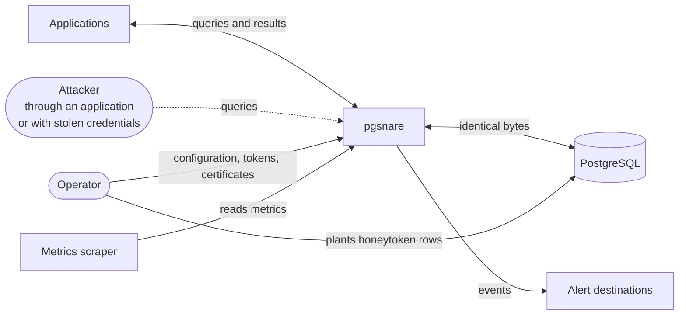
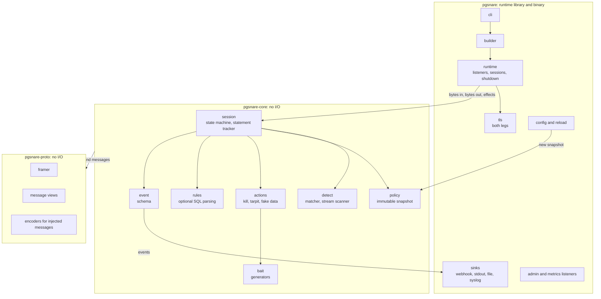
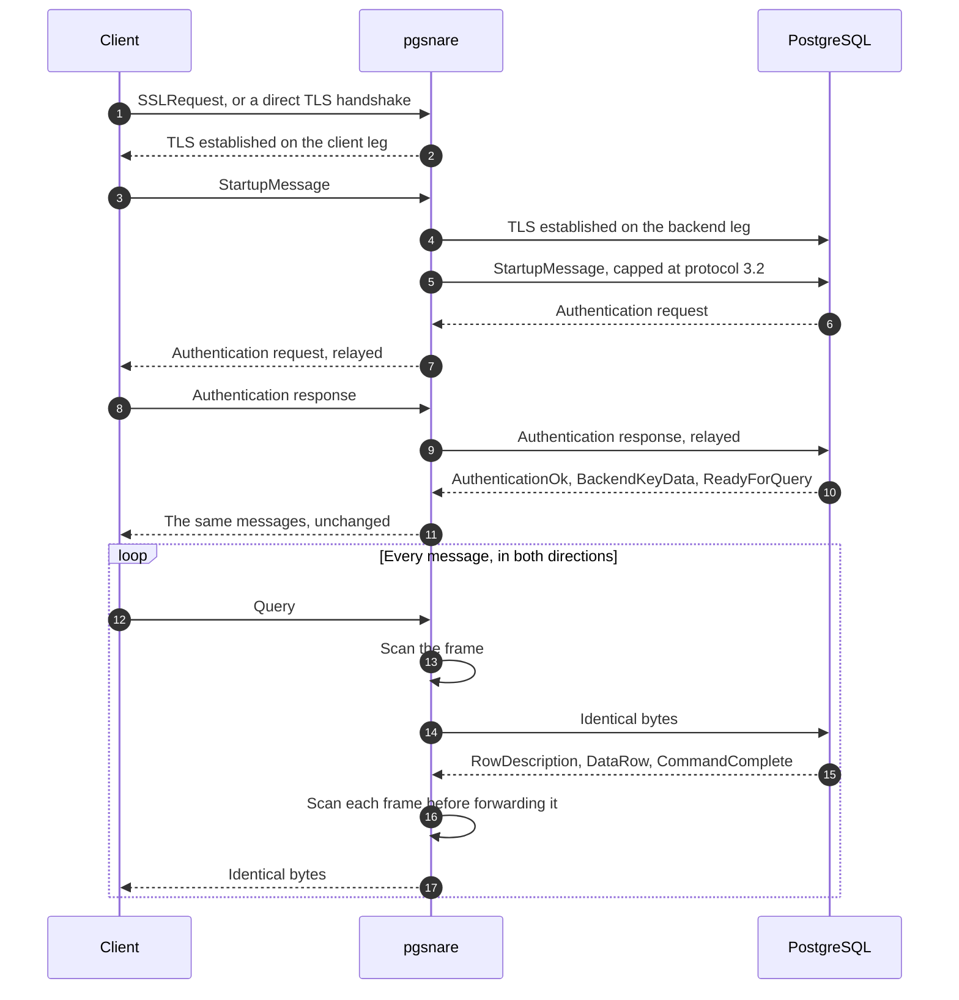
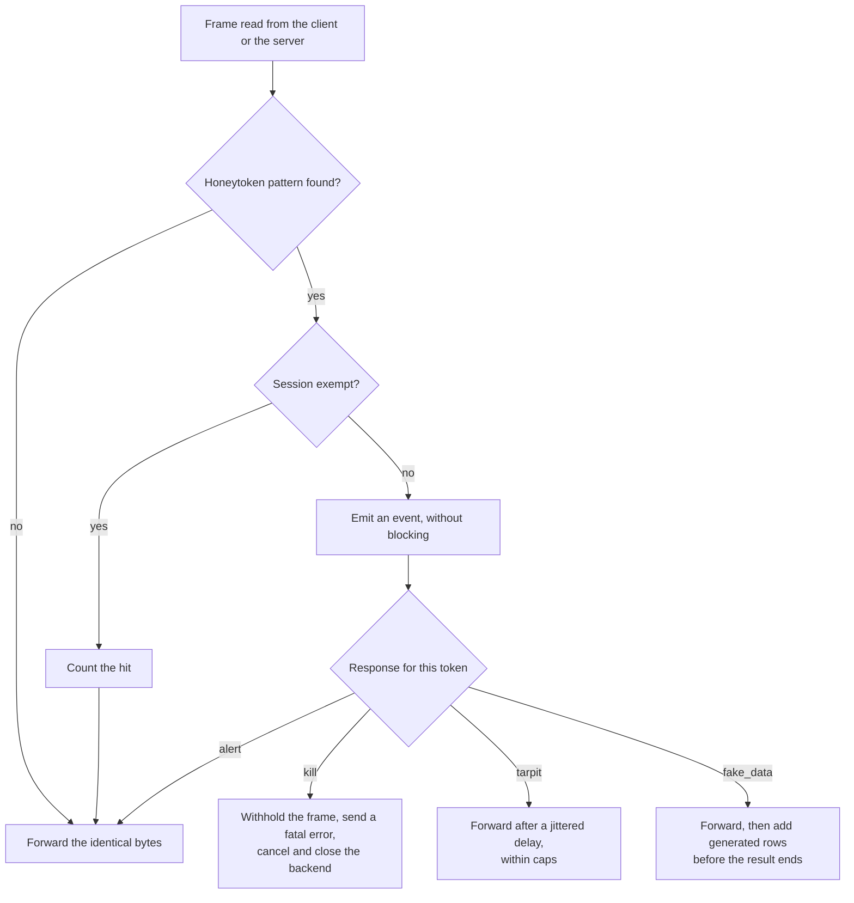
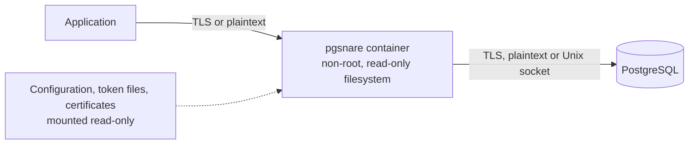
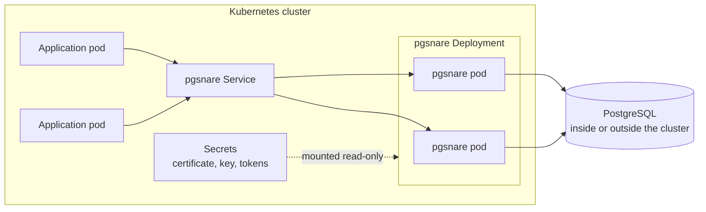
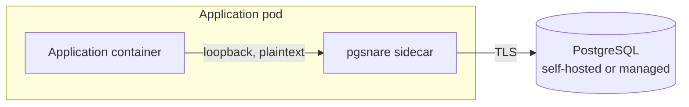

# pgsnare: high-level design

> [!NOTE]
> Status: draft. This document describes the intended design of the first version. Nothing in it is implemented yet, and details may change as the implementation proves or disproves them.

## Contents

1. [Purpose](#1-purpose)
2. [Goals and non-goals](#2-goals-and-non-goals)
3. [Terms](#3-terms)
4. [System context](#4-system-context)
5. [Architecture](#5-architecture)
6. [Wire protocol](#6-wire-protocol)
7. [Authentication and TLS](#7-authentication-and-tls)
8. [Detection](#8-detection)
9. [Responses](#9-responses)
10. [SQL rules](#10-sql-rules)
11. [Policy, configuration and reload](#11-policy-configuration-and-reload)
12. [Events and observability](#12-events-and-observability)
13. [Extension points](#13-extension-points)
14. [Deployment](#14-deployment)
15. [Security design](#15-security-design)
16. [Quality targets](#16-quality-targets)
17. [Verification](#17-verification)
18. [Open points](#18-open-points)

## 1. Purpose

pgsnare is a proxy for PostgreSQL that detects data theft with honeytokens. It sits between applications and a real database, relays their traffic byte for byte, scans every message for honeytoken values, and responds when one appears.

This document sets out the design at the level needed to build it: the parts, how they interact, the decisions behind them, and the security requirements every part must meet. It is written for people who will implement, review or deploy pgsnare.

## 2. Goals and non-goals

### Goals

1. **Transparency.** Applications change only the host and port they connect to. Logins, TLS, prepared statements, COPY, notifications and cancellation work as they do against the database directly.
2. **Detection on data.** A honeytoken value is detected in any message, in either direction, however the query that produced it was written.
3. **Configurable response.** Each token decides what happens on a hit: alert, kill, tarpit, fake data, or a combination.
4. **No added risk.** pgsnare holds no database credentials, fails closed, and cannot be crashed or bypassed by malformed input.
5. **Supported PostgreSQL versions.** pgsnare targets the versions supported upstream, 15 to 18 today, with wire protocol 3.0 and 3.2 and direct TLS.
6. **Container-native.** It runs as a standalone container or in Kubernetes, without needing exceptions from a locked-down platform.
7. **Low overhead.** The targets are in [section 16](#16-quality-targets).

### Non-goals for the first version

- Databases other than PostgreSQL.
- PostgreSQL versions that are no longer supported upstream.
- Encryption, masking or any other change to real data.
- Connection pooling or load balancing.
- A user interface. Events go to existing tools.
- Behavioural or statistical anomaly detection.
- Detecting values that were transformed inside the database before leaving it.
- Planting honeytokens automatically. pgsnare generates them; the operator inserts them.
- A Kubernetes operator, automatic sidecar injection, or service-mesh integration.
- PROXY protocol support.
- Builds for Windows or macOS.

## 3. Terms

| Term | Meaning |
|---|---|
| Honeytoken | A fake value planted in the database that no legitimate code reads. Reading it is the signal. |
| Client leg | The connection between an application and pgsnare. |
| Backend leg | The connection between pgsnare and the database. |
| Frame | One protocol message: a type byte, a four-byte length and a body. |
| Session | One client connection paired with one backend connection. |
| Sink | A destination for events, such as a webhook. |
| Channel binding | A SCRAM feature that ties a login to the TLS certificate the client saw. |

## 4. System context



- **Applications** connect to pgsnare exactly as they would to the database.
- **An attacker** reaches the database the same way: through a vulnerable application or with stolen credentials. pgsnare cannot tell the two apart until a honeytoken is touched, and does not need to.
- **The operator** plants honeytoken rows in the database and gives pgsnare its configuration, token list and certificates.
- **Alert destinations** receive events.
- **A metrics scraper** reads counters and histograms.

One condition is outside pgsnare's control: the network must force database traffic through pgsnare. A client that can reach the database directly is not seen.

## 5. Architecture

### 5.1 Components



| Crate | Responsibility | I/O |
|---|---|---|
| `pgsnare-proto` | The wire format: framing, typed views of the messages pgsnare must understand, and encoders for the few messages it injects. | None |
| `pgsnare-core` | The session state machine, detection, policy, actions, optional SQL rules, the event schema and bait generators. | None |
| `pgsnare` | The runtime as a library with a thin binary on top: listeners, TLS, configuration and reload, sinks, admin and metrics listeners, and the CLI. | All of it |

The session logic takes bytes in and returns bytes out plus *effects*: close, cancel, delay, emit an event. It never touches a socket or a clock.

This is the central structural decision. The whole session logic can be unit-tested and fuzzed with arbitrary interleavings of client and server bytes, which is how the requirement "no input can crash the proxy" is enforced rather than hoped for.

All three crates forbid `unsafe` code.

### 5.2 Path of one session



1. **Classify the first bytes.** A new connection starts with one of: a TLS handshake (direct TLS), `SSLRequest`, `GSSENCRequest`, `CancelRequest` or `StartupMessage`.
2. **Connect upstream.** On `StartupMessage`, pgsnare scans its parameters, connects to the database with TLS as configured, and forwards the startup message.
3. **Relay the login.** Authentication messages pass through unchanged in both directions. pgsnare records the cancel key the server issues.
4. **Steady state.** For each read: split into frames, scan, consult the policy, then forward, withhold or inject, and hand any effects to the runtime.

## 6. Wire protocol

**Forwarding.** A small framer locates messages. They are scanned in place and forwarded as the identical bytes. Byte-identical forwarding is both the fastest path and the strongest transparency guarantee: client and server see exactly what the other sent.

**What pgsnare rewrites or injects.** Only these:

| Message | When |
|---|---|
| SASL mechanism list | In one TLS setup (see [section 7](#7-authentication-and-tls)) |
| `NegotiateProtocolVersion` | When capping the protocol version |
| `CommandComplete` row count | After adding fake rows |
| `DataRow` | Fake rows |
| `ErrorResponse` | The `kill` response |

**Versions.** Protocol 3.0 and 3.2 are relayed. They differ in one thing: the cancel key is 4 bytes in 3.0 and 1 to 256 bytes in 3.2. pgsnare reads the key by its length, so both work.

**Negotiation is capped at what pgsnare understands.** A startup message asking for a minor version above 3.2, or carrying protocol options pgsnare does not know, is forwarded as 3.2 without those options, and the client is told through `NegotiateProtocolVersion`. Client and server can therefore never agree on a format pgsnare cannot parse.

**Cancellation.** A `CancelRequest`, with any key length, is forwarded verbatim to the database on a fresh connection. Keys are never rewritten, so pgsnare keeps no lookup table and any replica can forward a cancel for any session.

**TLS negotiation.** Both styles are accepted: `SSLRequest` followed by a handshake, and direct TLS, which requires the `postgresql` ALPN as the server itself does. `GSSENCRequest` is declined. After an `SSLRequest`, any plaintext already buffered is rejected on both legs. This closes the injection flaw PostgreSQL fixed as CVE-2021-23214 and CVE-2021-23222.

**Unknown messages** are framed generically, scanned and passed through. A startup phase that cannot be parsed ends the connection.

**Limits.** Every size or count taken from the network is bounded: the startup packet (10 kB, PostgreSQL's own limit), frames held in memory, connections per listener, and the time allowed before login.

## 7. Authentication and TLS

pgsnare relays logins and never terminates them. It does not know any password and holds no database credentials. TLS, by contrast, is terminated on both legs, because pgsnare must read the traffic.

This combination has one consequence that shapes deployment. SCRAM channel binding ties a login to the server certificate the client saw, and the server detects both a mismatch and a downgrade. A relay that does not know the password cannot get around either check.

The combinations below were verified against PostgreSQL 18.6 with a libpq 18 client.

| Client leg | Backend leg | What pgsnare does | Result with default client settings |
|---|---|---|---|
| TLS, presenting the database's own certificate and key | TLS | Relays the login unchanged | Works, including `channel_binding=require` |
| TLS, pgsnare's own certificate | Plaintext or Unix socket | Relays unchanged | Works. `channel_binding=require` fails, because there is nothing to bind to |
| Plaintext | TLS | Removes `SCRAM-SHA-256-PLUS` from the server's offer | Works |
| Plaintext | Plaintext | Relays unchanged | Works |
| TLS, pgsnare's own certificate | TLS | Relays unchanged, or removes `SCRAM-SHA-256-PLUS` | Fails for clients that use channel binding, which libpq does by default. Works only with `channel_binding=disable` |

Supported setups, in order of preference:

1. **Shared certificate.** pgsnare is given the database's certificate and key. Clients cannot tell the difference and channel binding keeps working.
2. **Next to the database**, with a plaintext or Unix-socket backend leg.
3. **Next to the application**, with a plaintext client leg and TLS to the database. This suits managed databases that enforce TLS and do not hand out the server key.

When both legs use TLS, pgsnare compares its client-leg certificate with the one the database presents and logs a clear warning at startup if they differ.

Not supported in the first version: login with client certificates, GSSAPI encryption, and a central proxy with TLS on both legs in front of a database whose key is not available. Those require pgsnare to terminate authentication itself.

## 8. Detection

### 8.1 Tokens and patterns

- A token is one or more values with an id, an optional scope hint used only for reporting, and its response.
- Values must be ASCII and at least 12 bytes. Matching then does not depend on the client's character encoding, and accidental matches are implausible.
- Each value compiles to a small set of byte patterns: the raw value, its lowercase hex form (how `bytea` is printed in text format) and, if requested, a case-insensitive variant.
- All patterns are matched in one pass with the Aho-Corasick algorithm.

### 8.2 What is scanned

Every message body, in both directions.

- **From the server:** result rows and COPY data, and also error and notice text, notification payloads, parameter status values and function-call results. Error text matters because error-based SQL injection leaks values through it.
- **From the client:** query text, bind parameters, COPY data and startup parameters. A honeytoken used as a database user name therefore fires at login, and a stolen honeytoken value fires when someone uses it in a query.

Because matching works on substrings of raw bytes, a value is found inside JSON, arrays, composite rows, aggregated strings and COPY output with no special handling.

### 8.3 Buffering and streaming

- A message up to `max_buffered_frame` (default 1 MiB) is scanned whole before any byte of it is forwarded. This is what lets `kill` withhold the row that contains the token.
- A larger message is scanned as a stream. The last bytes of each chunk are carried over, so a value split across chunks is still found, and the message is forwarded chunk by chunk. For such a message, bytes that come before the token inside the same message can reach the client.
- Whole results are never buffered. Memory use is bounded whatever the result size.

### 8.4 Detection does not depend on state

Detection is stateless per message. Knowing which statement produced a row is the job of a statement tracker, and it only enriches the event. If tracking ever loses sync, the event reports the query as unknown and the hit is still raised. SQL parsing is never on the detection path.

### 8.5 Decision flow



The diagram shows one response per hit for clarity. A token can combine several.

### 8.6 Known gaps

Result inspection cannot see everything, and the documentation must say so.

- **Transformed values.** A value hashed, cut, re-encoded or encrypted inside the database before it leaves does not match. Planting several tokens across several columns reduces the exposure.
- **Blind extraction.** Boolean or time-based SQL injection infers data without ever returning it. The optional SQL rules can flag the functions such attacks rely on.
- **Rows already sent.** `kill` withholds the row containing the token, not the rows that preceded it in the same result. Token placement matters.
- **Bypass.** Traffic that does not pass through pgsnare is not seen.

## 9. Responses

| Response | Behaviour |
|---|---|
| `alert` | Emit an event. The session continues. This is the default. |
| `kill` | Withhold the matching message. Send the client a `FATAL` error that looks like an administrator terminating the session (SQLSTATE `57P01` by default) and close the connection. Then send a cancel request with the session's own key and close the backend connection. No database credentials are needed. |
| `tarpit` | Delay each flush to the client by a jittered interval, with an optional rate cap. A tarpitted session keeps a real database connection busy, so it is bounded by a maximum duration and a maximum number of tarpitted sessions. Past either limit, the session is killed. |
| `fake_data` | Insert generated rows before the end of the result and adjust the reported row count. Rows are built by recombining values sampled from the real rows of that result, with generated bait in credential-like columns. This needs a text-format result with a known row description; otherwise it falls back to `alert`. |

- **Combination and escalation.** A token can list several responses, and can upgrade its response after a number of hits in the same session.
- **Flagged sessions.** Once a session has triggered, each later statement emits a `session_activity` event, giving a timeline of what the session did next.
- **Exemptions.** Hits from a listed database user or client address range are counted and trigger nothing. Without this, a backup, a replica or an ETL job that reads whole tables through pgsnare would fire every time. Address-based exemptions are only as trustworthy as the address pgsnare sees; see [section 14.5](#145-scaling-and-client-addresses).

## 10. SQL rules

Rules are optional. They flag suspicious statements before any data is read:

- catalogue enumeration by application users
- unbounded reads of tables marked sensitive
- results above a row threshold on those tables
- functions that read files or run programs

How they are built:

- Statements are parsed with the PostgreSQL 18 grammar through the `pg_query` library, which embeds PostgreSQL's own parser.
- The parser is the only C code that receives attacker-controlled input, so it is isolated. It sits behind a build feature, runs on a dedicated thread pool, has an input size cap, and is never on the detection path. A build without the feature contains no C code.
- A statement that fails to parse follows a configured policy: allow, alert or block. It is never silently ignored.
- Verdicts are cached by a hash of the statement text.

## 11. Policy, configuration and reload

- **Snapshot.** Tokens, compiled patterns, rules, exemptions and sink settings form one immutable snapshot. A reload builds a new snapshot off the data path and swaps it in atomically. Sessions see it at their next message. An invalid file keeps the old snapshot and raises a log line and a metric.
- **Reload triggers.** `SIGHUP`, or a change to a watched file, including the atomic symlink swap Kubernetes uses for mounted volumes. Listener changes need a restart.
- **One YAML file**, with honeytoken values optionally in separate files so they can be stored as a secret.
- **Secrets** such as webhook signing keys come from environment variables or files, never from the configuration body.
- **File permissions.** pgsnare refuses to start if a private key, token file or configuration file is open to other users, unless explicitly overridden. The rule is PostgreSQL's own: a file owned by the process user must not be readable by group or others, and a root-owned file may be group-readable.

The sketch below is illustrative. The exact schema is not final.

```yaml
listeners:
  - name: main
    listen: 0.0.0.0:5432
    upstream: db.example.com:5432        # or unix:/var/run/postgresql/.s.PGSQL.5432
    client_tls:   { mode: require, cert: /etc/pgsnare/server.crt, key: /etc/pgsnare/server.key }
    upstream_tls: { mode: verify-full, ca: /etc/pgsnare/root.crt }

inspection: { on_error: fail_closed, max_buffered_frame: 1MiB }

token_files: ["/etc/pgsnare/tokens/*.yaml"]          # for example a mounted secret
tokens:
  - id: users-admin-backup
    values: ["svc.backup.8f3k2q@mail.example"]
    scope: { database: app, table: public.users }    # reporting hint only
    actions: [alert, kill]
    escalate: { after_hits: 3, to: [kill] }

exemptions:
  - { db_user: backup, client_cidr: 192.0.2.5/32 }   # nightly backup

actions:
  tarpit: { delay: 2s-30s, max_duration: 10m, max_sessions: 50 }
  fake_data: { rows: 500 }

events:
  query_redaction: fingerprint                       # full | fingerprint | none
  dedup_window: 60s
  labels_from_env: [POD_NAME, POD_NAMESPACE]         # instance labels on every event
  sinks:
    - { type: webhook, url: "https://alerts.example.com/hooks/pgsnare", hmac_secret_env: PGSNARE_WEBHOOK_SECRET }
    - { type: stdout }

admin:   { listen: 127.0.0.1:9641 }                  # health, loopback only
metrics: { listen: 127.0.0.1:9642 }
```

## 12. Events and observability

Events are versioned JSON objects.

| Group | Fields |
|---|---|
| Identity | `event_id`, `timestamp`, `kind`, `session_id`, instance labels |
| What fired | `token_id` or `rule_id`, `action_taken`, `hit_count`, `direction`, `message_type` |
| Who | `client_ip`, `client_port`, `db_user`, `database`, `application_name`, `tls` |
| Context | `query` (redacted as configured), `rows_so_far`, `session_flagged` |

Event kinds are `token_hit`, `rule_hit`, `parse_failure`, `session_activity` and `inspection_bypassed`.

- **Token values never appear** in events, logs or metrics; only token ids do. Passwords and key material are never logged. Bind parameters and full query text are off by default.
- **Delivery never blocks traffic.** The data path hands events to a bounded queue without waiting. A dispatcher deduplicates, rate-limits and fans out to sinks, each with its own bounded queue and retry with backoff. Dropped events are counted.
- **Sinks:** webhook (HTTPS, with an HMAC-SHA256 signature header), standard output, file, and syslog (RFC 5424).
- **Metrics** are exposed in Prometheus format on their own listener: connections, queries, bytes, hits, actions, parse failures, queue depth and drops, and a histogram of added latency.
- **Health.** `/healthz` and `/readyz` are served on a loopback-only admin listener and queried by the built-in `pgsnare healthcheck` command.

## 13. Extension points

The public crates expose three interfaces:

- a **login strategy** (the first version ships one: relay)
- an **event sink**
- a **protocol module** boundary (the first version ships PostgreSQL)

Detection, policy and events contain no PostgreSQL-specific types. A builder assembles a proxy from these parts, so another build can add its own implementations without forking the core.

Extensions are compiled in. There is no runtime plugin loading, no dynamic libraries and no scripting, which leaves the attack surface unchanged.

## 14. Deployment

### 14.1 The container image

- One image holds the static binary, CA certificates and a non-root user. It has no shell and no package manager.
- It is built for x86_64 and aarch64 and published to the GitHub Container Registry. Examples pin it by digest.
- It runs as a non-root user with no Linux capabilities and a read-only root filesystem.

### 14.2 Lifecycle

- pgsnare runs correctly as process 1 of a container.
- On `SIGTERM` it stops accepting connections, reports not-ready, lets open sessions finish for a configurable grace period, then closes the rest with the same error the database sends on an administrator shutdown.
- `pgsnare healthcheck` asks the loopback admin listener and exits 0 or 1. It backs the image's health check and Kubernetes exec probes, so no health port has to be exposed.
- Worker threads follow the container's CPU limit.

### 14.3 Standalone container



Docker or Podman, including Compose. Configuration, token files and certificates are mounted read-only.

### 14.4 Kubernetes

One Helm chart is the source of truth. It is published as an OCI artefact to the same registry and signed like the images, and each release attaches the plain manifests rendered from it.

**Central proxy.** A Deployment and a Service in front of the database. Every application connects through the Service. With TLS on both legs it uses the shared-certificate setup, with the database's certificate and key in a Secret.



**Sidecar.** A pgsnare container in the application pod, declared as a native sidecar where the cluster supports it, so it starts before the application and stops after it. The application connects over loopback and pgsnare uses TLS to the database.



**Chart defaults.**

- Pods meet the "restricted" Pod Security Standard and mount no service-account token.
- Resource requests and limits are set.
- A default-deny NetworkPolicy lets only the listed clients in, and only the database, DNS and the alert sinks out.
- A PodDisruptionBudget is included.
- Honeytoken values live in a Secret, not a ConfigMap. Changing the Secret takes effect without a restart.
- The metrics listener is exposed only to the scrapers the NetworkPolicy allows.

### 14.5 Scaling and client addresses

- **Replicas are independent.** There is no shared state, and cancel requests work through any replica. Deduplication windows and tarpit caps apply per replica.
- **Instance labels.** Events carry labels such as pod and namespace, read from environment variables. In the sidecar pattern the client address is always loopback, so these labels identify the application.
- **Hidden client addresses.** Behind a load balancer that hides client addresses, events show the load balancer's address, and address-based exemptions must not be used there.

## 15. Security design

pgsnare sits inline in front of production databases, sees all traffic and may hold the database's TLS key. It is a target in its own right, so the requirements in this section apply to every part of it.

### 15.1 Threat model

| Adversary | What must hold |
|---|---|
| Unauthenticated network client | Cannot crash, stall or exhaust the proxy, and gains no access to the database it would not have directly |
| Authenticated database user, the attacker pgsnare exists to catch | Sees no pgsnare-specific behaviour in the protocol, cannot switch off inspection or desynchronise it with crafted messages, and cannot read tokens or configuration |
| Malicious or compromised database server | Malformed server messages cannot crash the proxy or affect other sessions |
| Reader of logs, events or metrics | Learns no token values, passwords, bind parameters or key material |
| Supply-chain attacker | A tampered dependency, CI action or release artefact is detectable |

An attacker with root on the pgsnare host is out of scope.

### 15.2 Secure defaults

- Inspection errors end the session (`fail_closed`). The alternative, `fail_open`, turns the session into an uninspected tunnel and emits an `inspection_bypassed` event; it must be chosen explicitly.
- TLS 1.2 is the floor and 1.3 is preferred. When upstream TLS is on, the certificate is verified. Turning verification off takes an explicit setting and is logged at startup.
- Private keys, token files and the configuration file must not be open to other users (see [section 11](#11-policy-configuration-and-reload)).
- The admin and metrics listeners bind to loopback by default and are read-only. There is no remote administration interface.
- Webhook sinks require HTTPS with certificate verification. Plain HTTP takes an explicit setting.
- Token values, passwords and key material never reach logs, events or metrics.

### 15.3 Hardening

- Runs as a non-root user with no Linux capabilities and a read-only root filesystem.
- The image has no shell or package manager, has its base pinned by digest, and is scanned for known vulnerabilities on every build and nightly.
- Every size or count taken from the network is bounded.
- Key material stays in memory only and is wiped when dropped where the libraries allow. Core dumps are disabled.
- A panic ends one session, not the process, and is counted. The count must stay at zero in fuzzing and soak tests.

### 15.4 Code safety

- `unsafe` code is forbidden in all pgsnare crates.
- In the protocol and core crates, lints deny `unwrap`, `expect`, `panic!`, slice indexing and unchecked arithmetic outside tests. Integer overflow checks stay on in release builds.
- Every parser has a fuzz target. A fuzz crash blocks release.

### 15.5 Supply chain

- `Cargo.lock` is committed and dependencies come only from crates.io.
- Advisories, licences and sources are checked on every push and nightly. Only permissive licences are accepted.
- A new dependency needs a stated reason in its pull request.
- CI runs only actions written by GitHub or by verified publishers, each pinned to a commit SHA, with a read-only token unless a job needs more. No secrets are exposed to pull requests from forks.

### 15.6 Release integrity

- Releases are built only by CI, from a tagged commit.
- Binaries, images and the Helm chart are signed and published with checksums, an SBOM and build provenance.
- Release tags are protected against deletion and rewriting.

### 15.7 Repository and process

- The main branch accepts changes only through pull requests made of signed commits. It cannot be force-pushed or deleted.
- Secret scanning with push protection, dependency alerts with automatic security fixes, and private vulnerability reporting are enabled.
- Examples and tests use reserved documentation values only, such as `example.com` hosts and `192.0.2.0/24` addresses. CI scans every push for secrets and for private network addresses.
- A written threat model is reviewed before the first release.

## 16. Quality targets

These are design targets, not measurements.

| Area | Target |
|---|---|
| Compatibility | PostgreSQL 15 to 18. Clients: psql and libpq 15 to 18, pgjdbc, node-postgres, psycopg 3, pgx, asyncpg and tokio-postgres. Every supported TLS setup. Protocol 3.0 and 3.2. |
| Added latency | At most 0.5 ms at the median and 2 ms at the 99th percentile, for queries that trigger nothing |
| Throughput | At least 90% of a direct connection in a select-only benchmark with 64 clients and 100 tokens loaded |
| Memory | At most 50 MB baseline plus 64 KB per idle connection |
| Detection | Every technique in a corpus of at least 50 in-band exfiltration techniques |
| False positives | None in a 24-hour soak with no honeytoken access |
| Alert latency | At most 2 seconds at the 99th percentile, from hit to webhook receipt |
| Robustness | No crash in 24 CPU-hours of fuzzing, and no panic reachable from network input |

## 17. Verification

- **Differential tests.** Every scenario runs twice, directly against PostgreSQL and through pgsnare, and the outputs must match. Scenarios cover simple and extended queries, prepared statements, pipelining, transactions and error recovery, COPY in and out, LISTEN and NOTIFY, cancellation, very large rows, cursors, and a logical replication stream.
- **PostgreSQL's own regression suite**, run through the proxy.
- **Detection corpus.** Each case is labelled as a hit or a known gap and run in simple, extended-text and extended-binary modes. Known gaps are asserted as misses, so the documentation stays honest.
- **Property tests.** The scanner finds the same matches however the bytes are chunked.
- **Fuzzing.** Framer, startup packets, the whole session logic with interleaved input, the configuration loader and the rule engine.
- **Leak test.** No token value, password or key reaches a log, event or metric.
- **Benchmarks.** One reproducible script with pinned CPU sets.
- **Container and Kubernetes tests.** The image runs with a read-only root filesystem and all capabilities dropped. The chart is installed into a namespace that enforces the restricted Pod Security Standard. Tests cover both Kubernetes patterns from install to first alert, a token added through the mounted Secret, a rolling update with drain, and NetworkPolicy isolation.

## 18. Open points

- Whether the reference benchmark on a 16-core machine is a release gate, or a scaled-down run is accepted.
